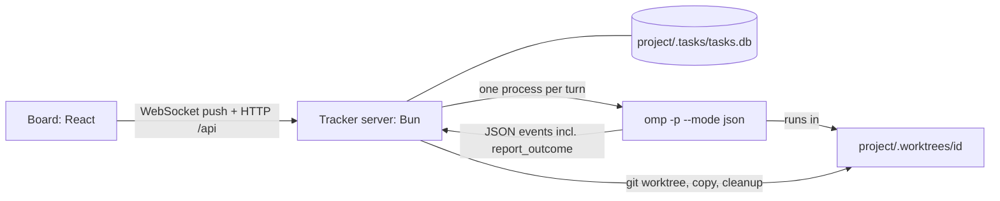
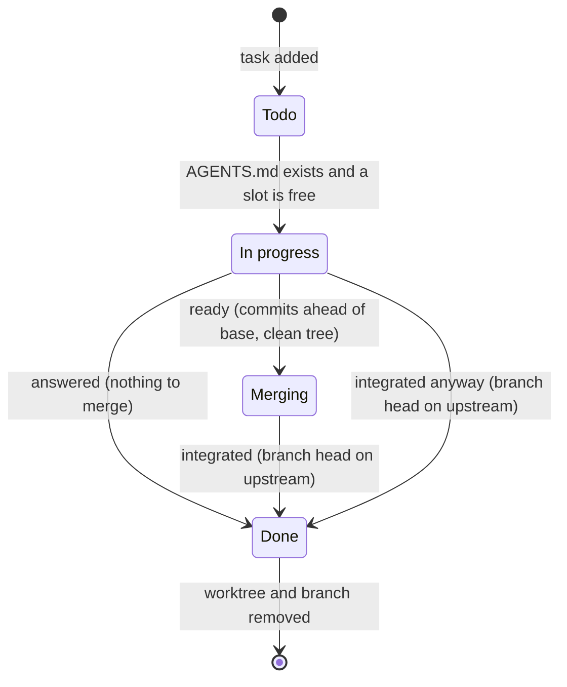

# Plan: omp-task-tracker

The design and decision log from the build of the first release: what each part is for, why it works the way it does, and what the first release phase list included. The [README](README.md) is the product overview; this file records the reasoning.

A local kanban board for all your git projects. You type a task in plain language. The tracker gives it its own git worktree, runs native omp in it, and merges finished work through a per-project merge queue without human review. The tracker only enforces the process: worktrees, merge order, outcome reporting and git checks. Quality comes from each project's own rules (`AGENTS.md`).

The tracker is project-agnostic. **two example projects appear below.**

## Decisions

| Topic | Decision |
|---|---|
| Stack | Bun + TypeScript + React, `bun:sqlite` (built into Bun), plain CSS. `package.json` with `start`, `check` (`tsc --noEmit`, biome over `src`, `scripts` and `extension`, boot smoke), `test` (`bun test`), `test:mutation` (StrykerJS in five runs: `stryker.config.mjs` for everything but the files below, then `stryker.release.config.mjs`, `stryker.turn.config.mjs`, `stryker.worktree.config.mjs` and `stryker.update-image.config.mjs`, each for one file with its git- or store-backed tests; each holds its own break threshold). Repo `C:/workspace/omp-task-tracker`, git, pushed to [github.com/ottr-ai/ottr](https://github.com/ottr-ai/ottr) (private); merge turns push `main` after each merge. |
| Storage | Per project: `<project>/.tasks/` (SQLite DB, logs, omp sessions) and `<project>/.worktrees/`. Each folder holds a `.gitignore` containing `*`, so both stay invisible to git. |
| Finding projects | Scan `C:/workspace/*/.tasks/` (the tracker's parent folder). Env `OMP_TRACKER_ROOTS` overrides it for projects elsewhere. |
| Worktrees | Every task gets one: `<project>/.worktrees/<id>/` on branch `ott/<id>-<slug>`. |
| Project rules in worktrees | Copy untracked `AGENTS.md`, `.omp/` and per-project extra paths into each new worktree. Committed rules arrive through git. |
| Projects without rules | When the project is added (or via the **Start rules interview** button / `POST /api/projects/:project/interview`), the tracker queues a rules interview card. It runs omp in the project's main checkout and interviews you with the ask tool, then writes `AGENTS.md`. The project's other tasks wait in Todo until the file exists. |
| Starting | Automatic. Todo is a queue. |
| Parallelism | Per-project setting, default 2 running omp processes, plus a global cap `OMP_TRACKER_MAX_TOTAL` (default 3) so several projects can never flood the machine (seen live: a boot started 10 agents). A card waiting for you holds no slot. |
| Merging | Tracker-run merge queue. Turn 1 plans, implements, verifies and commits. Turn 2 rebases, re-verifies and integrates, one at a time per project. |
| Outcome reporting | A tracker omp extension adds a `report_outcome` tool plus a `session_stop` hook that makes calling it mandatory. The tracker cross-checks every claim with git. |
| Review | No human review or approval step. Humans are involved only when a task asks (hard stops, questions, failures). |
| Board | A desktop-app shell in the ISA-101 high-performance HMI style: grey is normal, and colour marks only alarms. An app bar shows machine load and agents in use. A sidebar lists the projects: **Overview** gives one table row per project, and each project has its own page. Columns: **Todo · In progress · Merging · Done**. **"!"** (amber triangle) = needs you; the card stays in its column, and an alarm banner under the app bar lists every task that needs you. A Done card whose integrate turn released a version shows it as a release link (e.g. `v0.28.2`). Visual rules: `DESIGN.md`. |
| Manual inputs | **Cancel** on any card and **Reply** on "!" cards. Queued cards can be reordered within a column by dragging or Alt+Arrow; no manual stage moves. The old drag position stays hollow, and the new slot follows card midpoints without showing next to the old position. |
| Done | Worktree and branch are removed automatically, unless the delete check finds uncommitted changes or commits not on the target: then the card gets "!" instead. Log, DB record and omp session stay. Follow-ups become new tasks. |
| Prompts | Tracker-owned templates. Turn 1 always contains the keyword `orchestrate` and a short list of the project's other in-flight tasks. |
| omp sessions | `--session-dir <project>/.tasks/sessions`, not `--no-session`: resume keeps working and tracker runs stay out of your manual session list. |
| Stable deployment | Run the board from a separate clone (never a worktree, never a project), in its own clone next to the main clone. It runs committed code only. Run it with `NODE_ENV=production` for the stable board: Bun serves the minified UI bundle and the server refuses `/api/ws`, so the tab polls `/api/state` every 5 s (update banner every 5 min) instead of holding a live socket. **Updates are manual:** the server pushes the behind-count vs `origin/main` over the board socket (refreshed every 5 min while a tab is open; `GET /api/update` serves the same value) and the board shows "New version available" when commits are pending; stop the server, run `bun run update` in the live clone, start it again. Since the 2026-10 production-mode push fix, push notifications still reach a phone with no tab open. The dev repo stays the dogfooding target for tracker tasks. |
| UI dev board | `bun run dev` (`src/dev.ts`): five demo projects in `.dev/` (seeded by `scripts/demo-data.ts`), `OMP_TRACKER_MAX_TOTAL=0`, port 5747. Never `bun start` in a checkout for UI work: it adopts every project in the parent folder and requeues the real board's running turns ("tracker restarted"), so they run twice. impeccable live mode injects its script into `src/ui/index.html` (config `.impeccable/live/config.json`) and Bun's HMR hot-swaps the variants. |
| Finish policy | Every finished task is committed, merged and pushed - enforced by the tracker: `ready` requires commits ahead of base, `integrated` requires the branch head on the upstream ref, and the merge-turn prompt orders an explicit push. Exceptions: `answered` (no-commit tasks like research) ends at Done without commits. If a project's own rules or hooks forbid pushing (e.g. a guard hook), the merge turn must report `needs_you` with the exact rule instead of finishing silently. |
| Releases | A per-project **Create release** button instead of a release in every merge turn. The plan (version, notes) is computed from Conventional Commits since the highest `vX.Y.Z` tag on the integration target; a review card verifies everything since that tag without changing code; when it approves, the tracker tags exactly the reviewed commit, pushes the tag and creates the GitHub release. Every publish step is idempotent; a failure gives the card "!" and a reply retries. A project can set a release command (`releaseCommand`); the tracker then runs it instead of its own tag, push and GitHub release, and checks the git state afterwards (see Releases). |
| Per-project `AGENTS.md` | Written per project; it describes the two-turn flow and the project's own checks. |
| Mobile access | Full parity from a phone . PWA served by the same Bun server, made responsive and installable to the home screen. Reach: Tailscale — `tailscale serve` terminates HTTPS for `<machine>.<tailnet>.ts.net` and proxies to the board on loopback (secure context required for PWA install); the hostname goes into `OMP_TRACKER_PUBLIC_HOSTS`. The server stays on the workstation for v1; sleep or reboot takes the board and running agents down. A TrueNAS container is a named future migration (see Left out). |
| Mobile auth | Usernames and passwords now, not Tailscale-only trust (the LAN and a bridged tailnet are untrusted). One admin user (no roles table): scrypt password hash, HMAC-signed session token in the `ottr.session` cookie (`Secure` on public hosts; 30 days with **Remember me**, otherwise the browser session). API clients use the key from **Settings → API key**. Direct loopback access stays open; existing Host/Origin checks stay. A loopback Host counts as direct only when the connection comes from loopback too: compose's published port (the Docker gateway) gets the login. |
| Mobile realtime and push | A WebSocket replaces the 2-second `/api/state` polling for in-app liveness (chosen over keeping the poll loop despite the bigger refactor). Lock-screen delivery: Web Push (VAPID via the `web-push` package), no self-hosted push server — the server sends a "needs you" notification itself; subscriptions live in the tracker DB (`.tasks/tracker.db`), endpoints answering 404/410 are pruned on the next send. WS alone cannot buzz a locked phone (OS suspends background sockets). Production mode (no WS) sends push without any tab; the 2-second-fallback polling rows above predate that. |
| Retro after Done | A supervisor pass files one retro card about 2 minutes after a card reaches Done, when the project setting **Retro** is on. Ottr computes the facts (cost, tokens, tool calls, errors, CI verdict, user replies) into the handoff; the agent only judges. The retro queues at most 3 lessons in Hindsight and proposes at most one improvement. Ottr files the proposal as a held card (`needs_you`) that starts only when you Accept, Edit or Decline it; at most 3 open proposals per project. Code guards stop the loop: no retro of a retro, no board token and no `create_task` in a retro run, one live retro per project, reviews stop at retro cards. A friction filter (on by default) skips smooth and cheap tasks (2026-10-14, [decision record](docs/decisions/2026-10-14-retro-proposal-gate.md)). |
| Fork research | With the project setting **Fork research** on, an hourly poll watches the project's GitHub forks and runs a tool-free model analysis over changed branches under quiet gates (24 h per fork, 3 per project per day, size cap, bounded timeouts, 3 retries then pause until a manual check). Results land as research cards; findings reuse the retro held-proposal mechanism, and fork-born tasks hold their merges until a reply approves them (2026-10-14, [decision record](docs/decisions/2026-10-14-fork-research.md)). |

## Verified on this machine (omp 18.3.0, Bun 1.3.14, Node 26.7.0, Git 2.40.1)

| Question | Result |
|---|---|
| Output | `omp -p --mode json` prints JSON lines. Line 1 is `{"type":"session","id",…}`. Text arrives in `message_update`, tools in `tool_execution_start` / `tool_execution_end` (with `isError`), and the run ends with `agent_end {messages, isTerminal}`. The last assistant message has a `stopReason`. |
| Prompt as data | A prompt on stdin works with no command-line argument, so user text is never parsed as a flag or `@file`. |
| Rules in the working folder | omp follows `AGENTS.md` in its working folder and loads `.omp/hooks/pre/*.js`. the example TypeScript project's guard hook blocked `git push`. |
| Rules from a nested worktree | **Not loaded.** From `<repo>/.worktrees/t1`, omp stops at the worktree root. The agent had to `cat ../../AGENTS.md` itself, and the main checkout's guard hook didn't block `git push`. Hence the copy step. |
| Resume | `-p --resume <id>` keeps the session id, appends to the same file and remembers earlier turns. |
| Images | `@<absolute path>` arguments work next to the stdin prompt in `-p --mode json`, also with `--resume`, and for files outside the working folder. omp builds one user message: the stdin text, then `<file name="<path>">[Image: original 200x100, …]` and an image block (converted to WebP). |
| Session folder | `--session-dir <dir>` puts the session file directly in `<dir>` and adds nothing to `~/.omp/agent/sessions`. `--resume <id> --session-dir <dir>` resumes it. `--no-session` makes resume impossible (docs). |
| Approvals | Effective `tools.approvalMode=yolo` with no per-tool policies, so no prompts. With `always-ask` forced, the tool is refused **but omp exits 0 with stopReason `stop`**. The tracker must flag this itself. |
| Long commands | A 70 s bash command moved to the background, the agent waited, and the process stayed alive until it finished. Release scripts can run inside `-p`. |
| Kill | `taskkill /PID <pid> /T /F` gives exit 1, no `agent_end`, no leftover children. A later `--resume` works, but the agent re-ran the interrupted command on its own. |
| TypeScript globs | the example TypeScript project's TS 7.0.2 with `include: ["**/*.ts"]` skips `.worktrees/` but type-checks a plain `tasks/` folder. That's why the folders start with a dot. |
| git | Self-ignoring folders keep the main checkout's `git status` clean. `git clean -ndx` would delete `.tasks/` but prints `Would skip repository .worktrees/t1`. |
| Browser TypeScript | `Bun.serve` with an HTML import bundles browser `.ts` on the fly, with no Vite. JSX needs `react` installed. |
| Windows Terminal | `wt.exe` is installed. |
| TypeScript project (example) | `release.mjs` works from any branch: it rebases onto `origin/main`, pushes `HEAD:refs/heads/main` + tag atomically and retries up to 3 times. `.dockerignore` is an allowlist, so `.tasks/` and `.worktrees/` never reach an image. |
| Django project (example) | Django project. No `AGENTS.md` in the repo and none at user level. CI runs on pushes to `main`; `v*` tags publish the image and the Android release. `.dockerignore` is an allowlist. |
| Question-only task (phase 4, the example TypeScript project) | Todo → Done in 65 s, outcome `answered`, exit 0. The worktree got `AGENTS.md`, `.omp/` and `scripts/release.mjs`; the agent only read files. the example TypeScript project's HEAD, `origin/main`, remote `main`, tags, `.git/info/exclude` and `git status` were unchanged, and the worktree and branch were removed. The answer first went only to the log (the agent's `details` described it instead of containing it); after the prompt and tool said the complete answer belongs in `details`, a rerun put the 18-step answer there (2870 chars, 80 s). |
| Real task (phase 6, the example TypeScript project) | Work turn 12.0 min → `ready` (commit `75c7d63`) → Merging → merge turn 8.3 min → `integrated`, v0.28.2 released. `details` holds `release.mjs` stdout verbatim with the changelog. Worktree, admin dir and branch were removed; the main checkout stayed clean and on v0.28.1 (its `main` doesn't move, so pull before your own work). |

Earlier approval prompts from Emdash and Vibe Kanban, per omp's docs (not reproduced): ACP sessions keep their own permission gate unless yolo is set explicitly, and the docs put the flag after the subcommand (`omp acp --approval-mode yolo`). The direct `-p` runs used here have no such gate.

### Observed event shapes

```jsonc
{"type":"session","version":3,"id":"01a0d425-…","timestamp":"…","cwd":"C:\\…"}   // always line 1
{"type":"message_update","assistantMessageEvent":{"type":"text_delta","contentIndex":1,"delta":"Z"}}
{"type":"tool_execution_start","toolCallId":"…","toolName":"bash","args":{"command":"git push origin main"},"intent":"…"}
{"type":"tool_execution_end","toolCallId":"…","toolName":"bash","result":{"content":[{"type":"text","text":"…"}]},"isError":true}
{"type":"agent_end","messages":[/* … */],"isTerminal":true}   // last assistant message: content[], stopReason ("stop" on success)
```

- Other types seen: `agent_start`, `turn_start`, `turn_end`, `message_start`, `message_end`, `tool_execution_update`. `assistantMessageEvent` kinds also include `thinking_*` and `toolcall_*`.
- Approval refusal (tool result, `isError: true`): `Tool "bash" requires approval but no interactive UI available.`
- Resume after a killed run prints on stderr: `Previous session ended while 1 tool call remained pending: …`

## Architecture



## Platform layer

All OS-specific operations go through one interface, `src/platform/`:

- `index.ts` — the `Platform` contract (`killTree`, `samePath`); picks `windows` or `unix` by `process.platform`. macOS comes later and will reuse `unix`.
- `windows.ts` — `killTree`: `taskkill /PID <pid> /T /F`. `samePath`: case-insensitive compare.
- `unix.ts` — `killTree`: one `ps` snapshot, then SIGKILL of the process and every descendant. `samePath`: exact compare.

| Operation | Windows | Unix |
|---|---|---|
| killTree | `taskkill /PID <pid> /T /F` | `ps` snapshot → descendants → SIGKILL each; if `ps` fails, still SIGKILL pid |
| samePath | case-insensitive | exact |

The server also splits `OMP_TRACKER_ROOTS` with `node:path` `delimiter` (`;` on Windows, `:` on Linux), and kills every running omp tree when it exits (exit handler plus SIGINT/SIGTERM/SIGHUP) so a restart cannot leave a second copy running.

## Layout

This tree predates the split into `src/app.ts`, `src/runner.ts` and `src/platform/`; it is kept as history. For the current code, read `src/` directly — the HTTP API is the `routes` object in `src/app.ts`, the board UI lives in `src/ui/`, and `extension/tracker.ts` is the omp extension.

Per project (example `C:/workspace/velvarr`):

```
.tasks/              .gitignore: *
  tasks.db           settings, tasks, turns
  logs/<id>.log      rendered run log, 2 MiB cap per task
  sessions/          omp session files (--session-dir)
  images/<id>/       pasted images (see Images)
.worktrees/          .gitignore: *
  <id>/              one worktree per task, branch ott/<id>-<slug>
```

With `OTTR_DATA_DIR` set (the compose stack: `/data`), the `.tasks/` content moves to `$OTTR_DATA_DIR/<folder name>/`; `.worktrees/` stays in the checkout.

## Data (SQLite per project)

The schema lives in `src/store.ts` (`TASKS_DDL`/`SCHEMA`, migrations right below) and the board-wide database in `src/globalStore.ts` (kv `config` holds the secrets listed under Security, plus push subscriptions). The bullets below are the original 2026-09 data model, kept as history; the live tables have grown (e.g. `tasks` now has `stage`/`state`, `model`, `follow_up_of`, `shots`, `release_version`, `release_notes`, `push_sha`).

- `settings(key, value)`: `max_parallel` (2), `copy_extra` (JSON list of relative paths, e.g. the example TypeScript project's `scripts/release.mjs`).
- `tasks`: `id, title, prompt, column (todo|in_progress|merging|done), needs_you, needs_reason, branch, base, worktree, session_id, summary, details, created_at, updated_at, done_at (when the card last entered Done; backfilled from the last turn's end), cancelled_at, images, pending_images, session_title` (images: JSON lists of image file names, see Images; `session_title`: the card's name, frozen once, see Board; `releaseVersion`: the version the task released — release cards get it at creation, merged tasks get it stamped from the integrate turn's report at merge time when a git tag of that name points at the pushed merge head; the boot pass applies the same tag gate to older cards and clears stamps whose tag no longer anchors them; `releaseNotes`: release cards only, see Releases).
- `turns`: `id, task_id, kind (work|merge), prompt, started_at, ended_at, pid, exit_code, outcome, question, error` (release turns are normal `work` turns).

## Task lifecycle



The "!" badge can appear on In progress and Merging cards. Reply re-runs that column's turn in the same session, and the card queues for a slot again. Cancel works in every column.

| Turn | Reported outcome | Tracker check | Result |
|---|---|---|---|
| work | `ready` | commits ahead of base and clean worktree | Merging (queued) |
| work | `answered` | no commits ahead of base | Done |
| work | `needs_you` + question | – | stays In progress, "!" |
| any | `integrated` | branch head reachable from the upstream branch | Done. A work turn counts too: an agent that integrated anyway (e.g. after a "continue to merging" reply) can't undo it. |
| merge | `needs_you` + question | – | stays Merging, "!" |
| any | none: omp exited 0 without a terminal end (the agent ended on a pending background job) | the previous turn didn't end the same way | stays, queued again with a `.` continue ("resuming"); otherwise "!" |
| any | no report, failed check, exit ≠ 0, approval refused | – | stays, "!" with the reason |
| any | would end in Done | delete check: worktree clean and HEAD on the target | otherwise stays, "!" "Kept the worktree: …" |

## Scheduler

- Per project: at most `max_parallel` running omp processes (default 2), of which at most one is a merge turn.
- Merge turns start before new work (oldest ready first), then work turns (oldest Todo first).
- "!" cards hold no slot; their worktree stays.
- Merge hold: while a release card of a project with a release command is queued or running, that project's merge turns wait (the release command pushes a fast-forward version commit on the reviewed commit; a merge that lands meanwhile would break it). A release card that waits for the user holds nothing.
- Projects without `AGENTS.md` in the main checkout (tracked or untracked): their Todo cards show "waiting for rules".
- On tracker start: turns still marked running are queued again with a continue (`.`) reply ("resuming", "Tracker restarted - resuming automatically"), which resumes the persisted omp session in the same worktree ahead of newer queued cards. Cancel on the card stops it instead. omp announces a session id at start but writes its file later, so a turn cut off in its first seconds leaves a session that can't resume: any turn whose session has no file starts a fresh session in the same worktree instead, with the lost-session note that **New session** sends, followed by the reply unless it is only `.`.

## Runner (per turn)

1. **First work turn, create the worktree:**
   - base = upstream of the main checkout's branch, read from its config and fetched first (`git fetch <remote> <branch>`), else the branch itself. An upstream that still doesn't resolve stops the turn with "!" before any worktree exists, instead of falling back to the local branch; a failed fetch only logs a warning and uses the last fetched state. The fetch moves the main checkout's `origin/<branch>`, nothing else;
   - `git worktree add -b ott/<id>-<slug> .worktrees/<id> <base>`;
   - copy untracked `AGENTS.md`, `.omp/` and `copy_extra`. Never copy `.env*`. A missing extra path fails visibly;
   - any copied path git doesn't already ignore is added to `.git/info/exclude` (shared by all worktrees);
   - `git status --porcelain --untracked-files=all` in the worktree must be empty.
2. **Spawn:** `omp -p --mode json --session-dir <project>/.tasks/sessions -e <tracker>/extension/tracker.ts [--resume <sessionId>]`, cwd = worktree, prompt on stdin, `windowsHide`.
3. **Stream:** render events into the log. Record the session id and the `report_outcome` call arguments (from `tool_execution_start`). Stderr goes into the log as `! ` lines.
4. **Exit:** classify with the table above, save, free the slot, schedule.
5. **Done:** once the outcome is verified with git and the delete check passes, `git worktree remove --force` and `git branch -D`. Logs, DB rows and sessions stay.
6. **Cancel:** `platform.killTree(pid)` if running (`taskkill /PID <pid> /T /F` on Windows; on Linux a `ps` snapshot, then SIGKILL of the process and every descendant). If the worktree holds uncommitted changes or commits not on the target (or the check can't run), keep worktree and branch, clear `cancelled_at` and give the card "!" with what was kept; the board then asks again, and yes cancels with `force`. Otherwise remove the worktree, delete the branch, set `cancelled_at`; the card leaves the board.

## Prompts

Turn 1 (work):

```
<your task text>

---
orchestrate this task following AGENTS.md: plan, implement, verify, and commit on branch <branch>.
Do not merge, push, tag or release: the tracker runs integration as a separate turn when this project's merge slot is free.
Other tasks in flight for this project:
- <title> (<column>, branch <branch>)
Before you finish, call report_outcome: ready (committed, needs integration), answered (question only, nothing to merge; put your complete answer in details) or needs_you (with the exact question).
```

Turn 2 (merge):

```
Your turn to integrate <branch>: rebase onto <upstream> (resolve conflicts keeping both intents), re-run the project's verification, then integrate exactly as AGENTS.md prescribes.
Call report_outcome: integrated (put the integration output, e.g. release stdout, verbatim in details) or needs_you with the exact question.
```

Reply: your text + a reminder to call `report_outcome`. When the tracker did not accept the previous turn's report (e.g. `ready` with no commits ahead of the base), the reply starts with `The tracker rejected your last report_outcome: <reason>`. omp never sees the tracker's verdict otherwise, so a plain reply got the same rejected report again.

## Releases

A per-project release, started with the **Create release** button on the project page, not by every merge turn.

1. **Preview** (`GET /api/projects/:project/release`): the tracker fetches the integration target and its tags and freezes the target head SHA. The previous release is the highest `vX.Y.Z` tag merged into that SHA (none: first release). From the non-merge commits since that tag it computes the version and the notes. Version: first release v0.1.0; a breaking change (`type!:` or a `BREAKING CHANGE:` footer) bumps the major version, or the minor while the major is 0; otherwise a `feat` bumps the minor; otherwise the patch; only docs/test/chore/ci/build/style commits mean nothing to release. Notes: one bullet per commit under **New features** (feat), **Bug fixes** (fix) and **Changes** (perf, refactor, revert, and non-conventional subjects), breaking commits listed in their type's section with a `**Breaking:**` prefix; docs, test, chore, ci, build and style stay out unless breaking. The first release has exactly one note: "First release." A blocked plan says why: nothing to release, tag already exists, commit not on the target, or a release already in progress.
2. **Start** (`POST /api/projects/:project/release` with `{sha}`): the server recomputes the plan for exactly that sha (the target head or an ancestor), refuses a blocked plan, and creates a release card: a normal task whose prompt is `releasePrompt`, first line `Release vX.Y.Z`, with `releaseVersion` and `releaseNotes` set in the same synchronous step.
3. **Review turn:** the release card runs like any task, but its worktree is created at the frozen base sha, not the current target head. The agent reviews every change since the last release and runs the project's full verification, including mutation testing. It must not edit, commit, tag, push or release; it reports `answered` to approve or `needs_you` with the blockers. A reply resumes the review; the reply prompt then lists the release outcomes.
4. **Publish:** when the review turn ends `answered` with no commits, the tracker (not the agent) runs the publish: an annotated tag at the frozen sha (error when the tag points elsewhere), `git push origin refs/tags/vX.Y.Z` (skipped without an origin), and for a project with a GitHub remote `gh release create` (skipped when it already exists). Every step is idempotent. Any failure gives the card "!" with "Release failed: …"; a reply re-runs the review, and its approval retries the publish. A release turn that commits gets "!" instead ("A release review must not commit."). Done summary: "Released vX.Y.Z". The release card skips the delete check; its worktree is disposable.
5. The Done release card shows its version badge, linking to the GitHub release when the project has a GitHub remote.
6. Requires `gh` (GitHub CLI) for GitHub releases, needed only when Settings holds no GitHub token. The tracker stores the GitHub token (and the API key, session secret, VAPID private key, Hindsight and alate keys) in plaintext in `.tasks/tracker.db`; treat that file as a credential store.
7. **Release command** (`releaseCommand` in the project settings, optional): when set, the publish runs that command instead of the tag, push and `gh release create`. The command line is split on spaces; double quotes group a part with spaces; no shell. It runs in the release card's worktree, checked out at the reviewed commit and holding the project's extra copy paths. The tracker sets `OTTR_RELEASE_VERSION` (e.g. `v0.34.0`), `OTTR_RELEASE_COMMIT` (the full sha) and `OTTR_RELEASE_NOTES_FILE` (a UTF-8 markdown file with the planned notes, outside the worktree). Stdout and stderr lines show live in the card's log; cancel kills the command. Afterwards the tracker checks with git: exit code 0; the tag is on origin (a local tag when the project has no origin); the tag's commit contains the reviewed commit; the tag's commit is on the target branch. A failure gives the card "!" with "Release failed: <reason>. Fix it, then reply to retry."; a reply runs the command again, so the command must be idempotent.
8. Merge hold: while a release card of a project with a release command is queued or running, that project's merge turns wait. The command pushes a version commit on top of the reviewed commit as a fast-forward; a merge that lands meanwhile would break it. A release card that waits for the user holds nothing. Start guard: **Create release** is blocked while one of the project's merge turns runs ("A merge is running. Start the release when it is done.").

**Rules interview** (project added without `AGENTS.md`): the tracker queues it as a card (`POST /api/projects/:project/interview` or the **Start rules interview** button; also fired by adding the project). The card runs omp in the project's main checkout — no worktree, no merge turn — and interviews you with the ask tool: questions show on the card, your replies resume the session. It writes `AGENTS.md` covering:
- the pipeline stages;
- the exact verification commands;
- what the merge turn does (merge and push, never tag or release) and how a release is cut (from the board's Create release button, behind a review turn);
- the review rules (read-only at a frozen commit, the full verification plus the file's review gates, findings as cards);
- hard stops;
- whether the file is committed, or kept local-only via `.git/info/exclude`.

A live interview card is never duplicated; `not-needed` comes back once `AGENTS.md` exists.

## Tracker extension (`extension/tracker.ts`)

- `report_outcome` tool: `status` (`ready` | `answered` | `integrated` | `needs_you`), `summary` (1–3 lines shown on the card), `details` (full report shown on the card: the complete answer for `answered`, the integration output verbatim for `integrated`), `question` (for `needs_you`).
- `session_stop` hook: while `report_outcome` hasn't been called, returns `{ decision: "block", reason: "Call report_outcome before finishing." }`. After 2 refusals it lets the session end, and the tracker marks the card "!" with "no outcome reported".
- `ask`: asks the tracker user a question with clickable choices; the run pauses and the answer arrives as the next user message.
- `create_task`: files a follow-up task card, linked back to the current one.
- `rename`: names the omp session; that name becomes the card's display name (`session_title`), frozen once set.
- `report_outcome`, `ask` and `rename` need no network or IPC: the tracker reads their calls from the JSON stream. `create_task` posts to the board's HTTP API (`OTTR_BOARD_URL`, with the board token where the board is not on loopback).

## Board (React)

- App bar: CPU, RAM and VRAM as bar indicators with an 85 % normal-band tick (amber above it, red from 95 %), the tightest provider quota window (same band), agents in use of the global cap, and the waiting count. A click opens the detail popover with per-core load, the 2-minute CPU trend, memory, every provider usage window with its reset time, and agents per stage. Quota comes from `omp usage --json`, refreshed every 5 minutes while a board tab is open and shipped in `/api/state` as `quota`; the Quota meter hides when omp reports no limits, and on phones it takes RAM's place in the bar.
- Sidebar: **Overview** and one entry per project with running and needs-you counts. The URL hash holds the open project. Overview: one table row per project with needs-you, stage counts, advisories (uncommitted main checkout, no `AGENTS.md`), last activity and a New task button.
- Project page: name, integration target, path, GitHub link, advisories, the queue, then four columns. Cards show a state mark (ring = queued, dot = running, amber triangle = needs you, check = done), the title, age, a status line, and on Done cards the commit count and the released version (stamped on the task by the tracker when the merge integrates, parsed from the integrate turn's report; release cards carry theirs from creation).
- Card title: the **first** title omp gave the task's own session (its first `title_change` record; line 1 of the session file only holds the latest), stored once in `session_title` and never overwritten. Merge turns, resumes and New session re-title sessions ("Rebase, Verify, and Merge Branch"); the card keeps its name. A follow-up is a new task with a fresh session, so it shows that session's title. The tracker generates the title itself in the prepare phase (default model over the auth gateway) and pins it on the session, so a card never waits for the run's rename; when generation fails, the card shows the task's prompt-derived `title`.
- New task: the **New task** button (project page or Overview row) or `N` on a project page opens a dialog per project. Enter adds the task, Shift+Enter adds a line, Ctrl+V pastes screenshots. A closed dialog keeps its draft.
- Add project: path. Creates `.tasks/` and `.worktrees/` with their `.gitignore`s, and settings (max parallel, extra copy paths). Without `AGENTS.md`, it queues the rules interview card.
- Card drawer:
  - turns with summary and details;
  - live log;
  - question + Reply box on "!" cards only;
  - Cancel, with confirmation (it may interrupt a release), and a second one naming the work that isn't merged when the delete check kept the worktree;
  - branch, worktree, and the terminal command `cd <worktree>; omp --session-dir <project>/.tasks/sessions --resume <id>`.
- Columns page at 6 cards; Done shows the latest landing first.
- Live updates: one push-only WebSocket (`GET /api/ws`) per tab, no polling. The server pushes the board state (card rows: no turns, no report text) whenever it changes (checked after every mutating request, every scheduler run, and every 1 s while a tab is connected, which catches file-driven changes like omp session titles), machine stats every 2 s, the update count, and a `log` notice when a task's log grows (at most 4 per second per task). Pushed frames are the only writer of the board state, so an older snapshot can never overwrite a newer one. The open drawer refetches its full task when its card row changes; the open log fetches new bytes from the last byte read on each notice. The socket reconnects with backoff (0.5 s up to 5 s); 15 s without a frame counts as offline (the server pings every 5 s). Relative ages re-render every 30 s.

## Images (Ctrl+V)

Screenshots pasted into New task or Reply go to omp with that turn's prompt.

- Board: an `onPaste` handler on both text boxes takes the clipboard's `image/*` files and shows a thumbnail row under the box, each with a remove button (`aria-label="Remove image N"`). Pasting text still works. Submitting sends the images base64-encoded in the same JSON request.
- Server: at most 8 images per message, each ≤ 10 MiB after decoding. The type comes from the file's first bytes (PNG, JPEG, GIF, WebP), never from what the browser claims; anything else gets 400. Files are saved as `<project>/.tasks/images/<task id>/<n>.<ext>` with names and extensions chosen by the server, git-ignored with the rest of `.tasks/`.
- Which turn gets which images: the task's own images go with every work turn that sends the original prompt (no omp session yet). Reply images go with the next turn only. Merge turns get none.
- Runner: `buildOmpArgs` adds `@<absolute path>` per image. omp puts them into the same user message as the stdin prompt, each tagged `<file name="<path>">`, so the agent also knows where the file is (e.g. to copy a logo into the repo). The turn's log header lists each attached image and its size, like copied files.
- Code: checking and saving in a new `src/images.ts` with `src/images.test.ts` (accepts the four formats; rejects other bytes, bad base64, oversized files, more than 8). A `buildOmpArgs` test covers the `@` arguments with and without `--resume`.

## API

The table below was hand-kept and drifted from the code (it covered 28 of the 60 routes). Kept as history; do not extend it. The live HTTP API is the `routes` object in `src/app.ts` (plus the static and WebSocket routes registered around it) — read it for the current path list, bodies and rules.

<details><summary>Historical API table (2026-09, partial and partly stale)</summary>

| Route | Body | Rule |
|---|---|---|
| `GET /` | | board (Bun HTML import) |
| `GET /manifest.webmanifest` | | PWA manifest (install to home screen) |
| `GET /icon-192.png`, `/icon-512.png`, `/icon-512-maskable.png` | | board icons for the manifest |
| `GET /api/state` | | projects + card rows (no turns, no report text) of all discovered projects; the board reads the same object from the socket |
| `GET /api/boot` | | `{onboarding}` — true until the single admin exists (setup dialog); public |
| `POST /api/setup` | `{name, password, githubToken}` | only while no admin exists: creates it (scrypt hash), the session secret and the API key, and stores the GitHub token (one word of `[A-Za-z0-9_]`, 20-255 chars; else 400); sets the session cookie; second call 400 |
| `POST /api/login` | `{name, password}` | verifies against the admin, sets the session cookie; 401 on a mismatch |
| `POST /api/logout` | | clears the session cookie |
| `GET /api/push/config` | | the VAPID public key; generated (and persisted in the tracker DB, `.tasks/tracker.db`) on first call |
| `POST /api/push/subscribe` | `{endpoint, keys:{p256dh, auth}}` | stores a push subscription in the tracker DB, `.tasks/tracker.db` (one per endpoint) |
| `POST /api/push/unsubscribe` | `{endpoint}` | removes the subscription |
| `GET /sw.js` | | service worker: shows push notifications, focuses the board on click |
| `GET /api/settings/api-key` | | the current API key (authed on public hosts) |
| `POST /api/settings/api-key` | | regenerates the API key, returns the new one |
| `GET /api/settings/github-token` | | `{tokenSet}`; the token itself is never returned |
| `POST /api/settings/github-token` | `{token}` | replaces the GitHub token the board's git, `gh` and merge turns use (as `GH_TOKEN`); a malformed token is 400 and keeps the old one |
| `GET /api/ws` | | WebSocket upgrade, push-only (see Board): `state`, `stats`, `update`, `log`, `ping` frames; `Host` and `Origin` must be `127.0.0.1:PORT`, `localhost:PORT` or a configured public host (public hosts need an `https://` origin and a session cookie on the handshake; a loopback Host whose connection is not loopback needs the cookie too), else 403/401 |
| `GET /api/projects/:project/tasks/:id` | | one task with its turns (turn prompts omitted); the drawer's data source |
| `GET /api/projects/:project/tasks/:id/log?from=N` | | up to 256 KiB from byte N, `X-Log-Size` header |
| `POST /api/projects` | `{path}` | a folder without a git commit is added gitless; creates `.tasks/` and `.worktrees/` |
| `POST /api/projects/:project/init` | | git-inits a gitless project and makes an initial commit; 409 when it already has one |
| `POST /api/projects/:project/settings` | `{maxParallel, copyExtra, releaseCommand?}` | validated; `releaseCommand` is a string or null, trimmed, `""` becomes null, at most 300 characters, one line |
| `POST /api/projects/:project/interview` | | queues the rules interview card (idempotent while one is live); `not-needed` when `AGENTS.md` exists |
| `POST /api/projects/:project/tasks` | `{prompt, images?}` | new task in Todo; `images` is a list of base64 strings (see Images) |
| `POST /api/projects/:project/tasks/:id/reply` | `{text, images?}` | only on "!" cards |
| `POST /api/projects/:project/tasks/:id/restart-session` | | "!" cards with a session: drops the broken omp session, queues a fresh-session work turn in the same worktree with a "continue from where the worktree stands" note |
| `POST /api/projects/:project/tasks/:id/cancel` | `{force?}` | any card; `{ok: false, kept}` when the delete check kept the worktree, `force: true` deletes anyway |
| `GET /api/projects/:project/release` | | ReleasePlan preview: `sha`, `from`, `version`, `notes`, `commits`, `blocked`; 409 when the target can't be resolved |
| `POST /api/projects/:project/release` | `{sha}` | starts the release card for that sha; 400 bad sha, 409 blocked plan |

</details>

## Security

- Binds `127.0.0.1` by default (port 4747, env `PORT`; env `OMP_TRACKER_HOST` serves beyond loopback). Rejects `Host` other than `127.0.0.1:PORT`, `localhost:PORT` or a configured public host (`OMP_TRACKER_PUBLIC_HOSTS`; blocks DNS rebinding). Requests under a public host need a login session or the API key.
- Every non-GET API request needs a same-origin `Origin`, bodyless POSTs included; a JSON body also needs `Content-Type: application/json`. Otherwise any web page could start agent runs on this machine.
- WebSocket: browsers do not apply the same-origin policy to WebSockets, so any web page could open `ws://127.0.0.1:4747` and read the board. `GET /api/ws` therefore requires an `Origin` of exactly `http://127.0.0.1:PORT`, `http://localhost:PORT` or `https://<host>` for a name in `OMP_TRACKER_PUBLIC_HOSTS` (a missing one is refused) on top of the `Host` check; a public host also needs the login. The socket is push-only; the server never parses inbound frames.
- Limits: body ≤ 64 KiB (≤ 32 MiB on the task and reply routes, which carry images), prompt ≤ 20k characters, ≤ 20 copy paths, ≤ 8 images per message of ≤ 10 MiB each.
- `:project` must be a discovered project and `:id` must match the id pattern before any path join. Working folders come only from the project's own worktrees.
- Copy paths: relative, no `..`, no `.env*`.
- Prompts go through stdin; `spawn` without a shell; the terminal launcher (`wt.exe` on Windows, the chosen emulator on Linux) gets only tracker-written arguments, and omp's `@` image arguments are paths the server chose.
- React escapes all text.
- Credentials: omp keeps its own login, but the tracker itself stores secrets — the admin scrypt hash, API key, session secret, VAPID private key and the GitHub, Hindsight and alate keys — as one plaintext JSON value under kv `config` in the board-wide `.tasks/tracker.db` (compose: the `ottr-state` volume). Treat that file as a credential store; never print or paste its contents. It never copies `.env*`. Logs and sessions stay local and git-ignored.

## Phases

| # | Work | Done when |
|---|---|---|
| 1 | Build: `git init`, `package.json`, server, runner, store, worktree, extension, board. | `bun test` (classify table, event rendering, copy-path rules, scheduler order) and `bun run check` pass. |
| 2 | Throwaway proof: a temporary git repo under `C:/workspace` with a codeword `AGENTS.md` and a guard hook, driven from the browser. | `report_outcome` is captured and finishing without it is blocked in `-p`. Two tasks editing the same line both pass the merge queue; the second rebases and resolves. Tracker restart mid-run gives "!" and Reply resumes. Cancel removes the process tree, worktree and branch. A project config with `approvalMode: always-ask` gives "!". A repo without `AGENTS.md` opens the rules interview. Foreign `Origin`/`Host` gets 403. The main checkout's `git status` stays clean. |
| 3 | Image paste (see Images). | `bun test` covers the image checks and the `@` arguments. In the browser, a pasted two-color PNG reaches omp and the card's answer names both colors; a Reply with a second pasted image gets the new colors from the resumed session. Bytes that aren't an image, and more than 8 images, get 400. |
| 4 | TypeScript project (example): add the project (`copy_extra`: `scripts/release.mjs`), then a question-only task. | Done with no commits and no release. |
| 5 | Write the example project's `AGENTS.md`: stages 1–5 in turn 1, stages 6–7 in the integrate turn. | File written. |
| 6 | One small real task in the example project. | Turn 1 → Merging → `release.mjs` stdout verbatim in details → Done, worktree removed. |
| 7 | Django project (example): add the project. | Rules interview produces `AGENTS.md`; the first real task passes the full flow. |

## Left out (add when needed)

- Human review/approval, Retry, manual stage moves: your call (quality comes from project rules). Stop-and-keep is covered where it matters: Cancel keeps a worktree with unmerged work and asks.
- Approvals answered in the UI (RPC mode): only if `tools.approvalMode` stops being yolo.
- Worktree setup commands (e.g. `bun install --frozen-lockfile`): the agent runs them per `AGENTS.md`.
- Autostart at login. (Markdown rendering in the card drawer shipped after this list was written; the deletion item below stands.)
- Images: thumbnails in the card drawer (the log lists the files), deleting images of finished tasks.
- herdr integration: surface tracker/pane state in a [herdr](docs/research/2026-09-26-herdr-pi-herdsman.md) workspace; only if interactive sessions and the tracker should share one supervision screen.
- Multi-user coop (future milestone from the 2026-09-29 grilling): full-equals users beyond today's single admin — task ownership, who answered which ask, who approved a merge, per-user audit log.
- TrueNAS container migration (future milestone): server, repos and agents in one container on the always-on NAS so the workstation can sleep. Repos on ZFS datasets; the image bakes omp, auth, skills and plugins; merges run container-side; Windows-to-Linux path fixes (`src/platform` has a unix fallback). A split (UI in container, agents on PC) stays rejected — it needs a remote-spawn protocol.

## Risks and unproven points

- A release in a merge turn took 8.3 min including CI (phase 6); a 40-minute CI wait is still unproven.
- **Line endings (not fixed):** scoop's Git sets `core.autocrlf=true` in its system config, and the example TypeScript project has no `.gitattributes`, so `git worktree add` wrote CRLF files. In the merge turn prettier's check failed on 64 files. The agent switched autocrlf off for its worktree, which put `extensions.worktreeConfig=true` into the example TypeScript project's shared `.git/config` (still there, inert without `config.worktree` files) and let the v0.28.2 release commit store `compose.yaml` with CRLF (no gate or CI checks it). Fix when needed: run the tracker's git and omp with `core.autocrlf=input` via `GIT_CONFIG_*` env, or give the project a `.gitattributes` (`* text=auto eol=lf`).
- Agents can still write a project's shared `.git/config` from a worktree; the tracker doesn't check it. Add a before/after comparison per turn when that matters.
- `git clean -fdx` in a main checkout deletes `.tasks/` (DB, logs, sessions). Worktrees survive, and agents never run in main checkouts. local-only rules share this risk.
- **Task merges advance `main` while your checkout is dirty.** The tracker's own git ops are safe with a dirty checkout - worktrees and branch ops never touch it - so merging is **not** blocked; instead the board shows an amber "uncommitted" flag on the project (scheduler-refreshed `isClean`) so you know your own pull/stash will collide. Structural fix: run the stable board from a separate clone, updated with `bun run update`.
- Processes omp starts as supervised services (e.g. dev servers) might survive the Cancel kill on both OSes and lock worktree files. Check in phase 2.
- A tracker crash: on Windows, libuv's job object should end the omp trees (not tested); on Linux, the server kills every running omp tree when it exits and on SIGINT/SIGTERM/SIGHUP, but a SIGKILL of the tracker leaves them running. Processes that survive may keep running after a restart, where the tracker resumes those sessions and they would run twice. Restart marks affected cards "!" when their turns were cut off.
- Cancel during a release can interrupt it midway; the example TypeScript project's script has `--resume`. After a kill, the resumed agent may re-run the interrupted command.
- A remote branch deleted since the last fetch only warns: the fetch fails, but its stale remote-tracking ref still resolves, so the worktree starts from it. Add `git ls-remote --exit-code` if that bites.
- The release badge stamps only when a git tag of the parsed version points at the pushed merge head, so report prose cannot mint one (fixed 2026-10-05; the earlier `release` field on `report_outcome` is unnecessary). Residual: the boot pass for pre-gate cards can only check that a tag of that name exists, not where it points — a legacy card naming an existing tag's version keeps a pill until a release card claims that version.
- Every task worktree gets its own `node_modules`. Default parallelism 2 keeps disk use and install time bounded.
- A Next.js dev server running in a main checkout may notice file churn inside `.worktrees/` (not verified, low impact).
