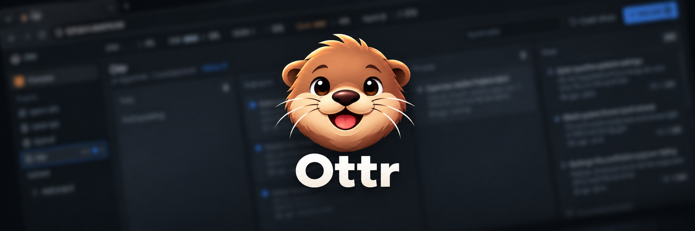
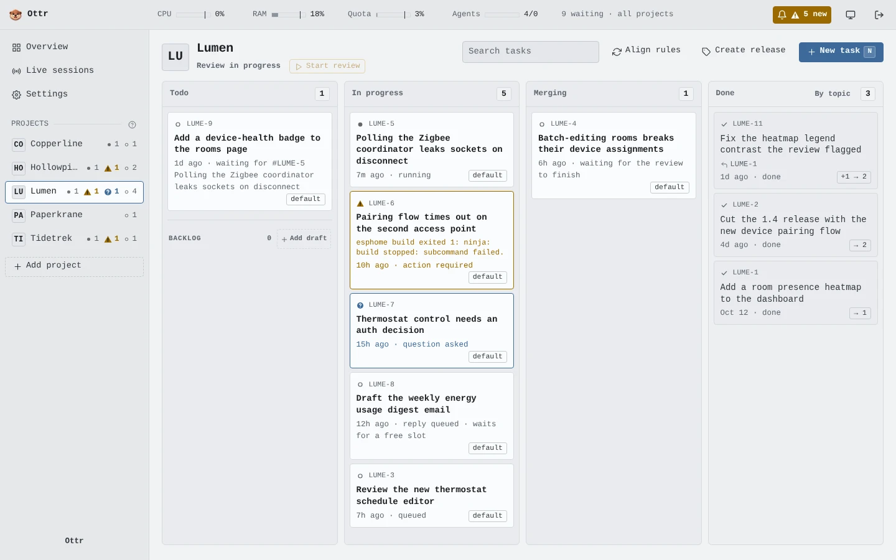
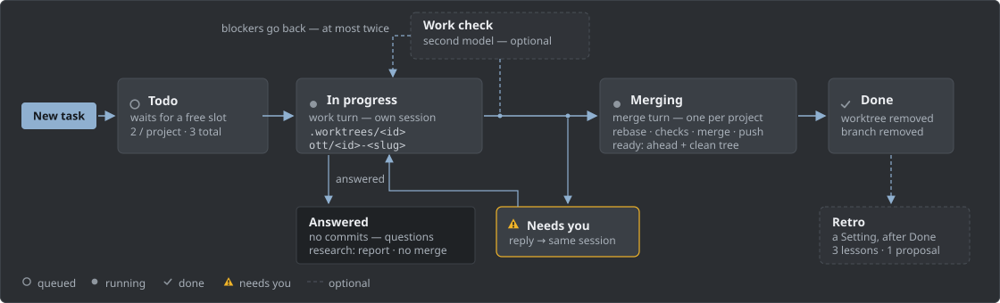
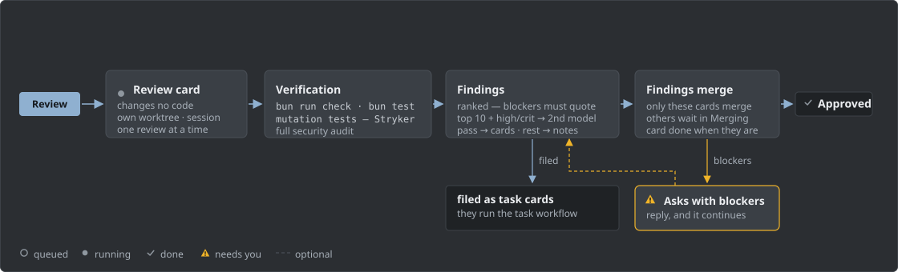
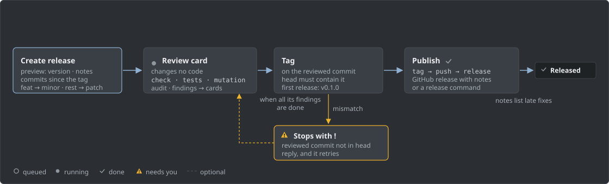

<p align="center">
  
</p>

<h1 align="center">Ottr – The Task Tracker for Oh My Pi</h1>

<p align="center">
  <a href="LICENSE"></a>
  <a href="https://bun.sh"></a>
  <a href="https://react.dev"></a>
  <a href="https://www.typescriptlang.org"></a>
  <a href="https://github.com/ottr-ai/ottr"></a>
</p>

Ottr (**O**hMyPi **T**ask **Tr**acker) is a local kanban board that runs omp coding agents on your git projects. You type a task in plain language. Ottr gives it a git worktree, runs the agent in it, checks the result, and merges through a per-project queue. It enforces the process; your project's `AGENTS.md` enforces quality. Everything runs on your machine; the board binds `127.0.0.1` by default.

<p align="center">
  
</p>

## How a task moves

<p align="center">
  
</p>

| Column | What happens |
|---|---|
| Todo | Waits for a free slot: 2 agents per project, 3 in total. Cards can declare dependencies and split into sub-task cards. |
| In progress | Ottr creates `.worktrees/<id>` on branch `ott/<id>-<slug>` and runs `omp -p` in it. The agent finishes with the `report_outcome` tool. |
| Merging | A second turn rebases, re-runs the project's checks, and integrates the work the way `AGENTS.md` says. One merge turn per project at a time. |
| Done | The report passed the git checks. Worktree and branch are gone. |
| Backlog | Parks ideas that are not ready to run. The list sits under Todo below a divider. A grill session refines an idea; a grilled card moves to Todo. While the grill session runs, the card leaves the backlog row and shows as a normal card in the Todo lane. |

Ottr checks every report against git: `ready` needs commits ahead of the base and a clean worktree; `answered` needs no commits; `integrated` needs the branch head on the upstream branch.

Before a card enters the merge queue, a second memory-less model checks it (optional, **Settings**): it reads the card, the diff and the transcript, and hunts for test tampering, fabricated actions, unmet acceptance items, logic errors and security flaws. A blocker must quote the diff or transcript; at most two send-backs, then the card waits on you.

A **research** task answers a question instead of changing code: the agent writes a report that Ottr archives on the card. Research cards end `answered` and never merge. The **Implement recommendations** button on a research report starts a follow-up task that implements the recommended steps of the report. That task files a separate card for each independent piece of work.

A **backlog** card holds a feature idea that is not thought through yet. Park a draft with **Add draft** in the backlog row of the todo lane, or press **B**; a draft runs no agent and picks no model. Open the card and pick **Grill with the agent** — or **Move to todo** — and you pick the model at that moment, or leave it empty to use the project's role model: the agent asks rounds of questions, you answer with a click, and the refined task text lands in the report. When the item is ready, pick **Move to todo**; Ottr appends the grilled definition to the prompt and the card enters the normal queue.

For a project with a GitHub remote, Ottr watches CI after each merge push and files a follow-up card when a run fails. Once an hour it turns each open Dependabot pull request into a card that runs like any task.

A card with **!** needs you. Reply in its drawer and the agent continues in the same session. You can also steer a running task, stop its current turn, cancel any card, paste images, and start follow-ups from Done cards. The bell in the header collects everything that needs you; desktop and phone push notifications are optional. Cards can carry a **triage rank** (P0-P3, set in the drawer): the Overview triage ranks them ahead of wait time, and a close-candidate badge marks cards you plan to cancel.

When a running turn writes nothing to its task log for 2 hours, its card shows a warning: the agent may wait on a hung command. Ottr does not stop the run. Steer, stop, or cancel the card. The warning goes away when the log grows again. A log that reached its 2 MiB limit keeps no new text, but new output still clears the warning.

If a turn fails without stderr, its card shows the provider's error when the event stream has one. The task log records it too. Ottr removes stored secrets, labeled secrets, URL credentials, and common API tokens from this error. A check run that dies because its model's provider has no usable sign-in names the provider on the card, with the fix: sign in again under Settings. The bell lists an advisory for every configured model role whose provider's stored sign-in omp has disabled, with omp's disabled cause and the role names.

## Workflows: review and release

<p align="center">
  
</p>

<p align="center">
  
</p>

The project's **Review** button starts a read-only review card: full verification, mutation tests, and a security audit. It ranks its findings and files the confirmed ones as task cards, and it is done only when they are all done. **Review learnings** on the project's settings page carry standing conventions into every review card's prompt, so a finding that only restates a learning is treated as noise.

**Create release** runs the same review since the last tag, then tags the reviewed commit and creates the GitHub release. Versions follow Conventional Commits; notes are one bullet per commit. A project can set a **release command** instead, which runs at the reviewed commit with `OTTR_RELEASE_VERSION`, `OTTR_RELEASE_COMMIT`, `OTTR_RELEASE_NOTES_FILE` and `OTTR_ARCH_REVIEW` in its environment.

While a review is open, only its finding cards merge — a release ships reviewed work and its fixes, nothing else.

## Requirements

- Windows 10/11 or Linux, with [Bun](https://bun.sh) ≥ 1.4.2, git, and `omp` on `PATH`. (macOS is not supported yet.)
- `gh` ([GitHub CLI](https://cli.github.com)) only for releases, when **Settings** holds no GitHub token.
- omp must run its tools without approval prompts; a one-shot `omp -p` run cannot answer them.
- Ottr stores tokens and keys (GitHub, API key, session secret, and more) in plaintext in `.tasks/tracker.db`. Treat that file as a credential store.

## Quick start

Docker Compose is the preferred way to run Ottr: the board and its worker containers share one image, so every turn gets the same pinned toolchain, and a restart of the host machine brings the whole stack back:

```sh
git clone git@github.com:ottr-ai/ottr.git ottr
cd ottr
export OTTR_WORKER_TOKEN=$(openssl rand -hex 32)   # server-to-worker auth
export OTTR_OAUTH_DIR=~/.omp/oauth                 # provider sign-ins, read-only
export OTTR_AGENT_DB=~/.omp/ottr-agent.db          # the stack's own omp auth db
# Seed it once with a consistent copy of the host db. Never mount the live file.
[ -e "$OTTR_AGENT_DB" ] || bun -e 'new (require("bun:sqlite").Database)(process.argv[1], { readonly: true }).run("VACUUM INTO ?", [process.argv[2]])' ~/.omp/agent/agent.db "$OTTR_AGENT_DB"
docker compose build
docker compose up -d
```

The `VACUUM INTO` line copies the host omp `agent.db` only when the snapshot does not exist yet. The server and the workers write to the snapshot, so the host db stays unchanged. Do not copy the host db over the snapshot again: sign the stack in under **Settings → Provider sign-in** ([docs/WORKERS.md](docs/WORKERS.md#env-settings) tells why).

Each GitHub release also publishes the image as `ghcr.io/ottr-ai/ottr` (amd64). A release publishes the tags `<version>`, `v<version>` and `latest`. To use it instead of a local build, replace the last two lines with:

```sh
export OTTR_IMAGE=ghcr.io/ottr-ai/ottr:latest
docker compose pull
docker compose up -d --no-build
```

The board never takes its config from the worker-writable home volume. Seed the board's own agent layer from your data repo once, then restart the board (see [Seed the board config](docs/WORKERS.md#seed-the-board-config)):

```sh
docker compose run --rm board-seed --repo <owner/name>
docker compose restart server
```

The hourly deploy repeats the seed by itself when the env file sets `ALATE_DATA` (a local data-repo checkout) or `ALATE_DATA_REPO` (`owner/name`). The board shows a notice while its agent layer is not seeded, or while a model role's provider has no active sign-in.

The board is then on <http://127.0.0.1:8080>. Optional: `OTTR_PORT`, `HINDSIGHT_API_URL` for fleet memory, and provider keys pass through from the host shell. [docs/WORKERS.md](docs/WORKERS.md) has the full topology, updates and crash story.

Hindsight is the preferred way to share memory between workers. Without `HINDSIGHT_API_URL`, omp keeps its default `mnemopi` memory: a local store in the shared home volume, so only containers on the same host see it. Set the URL to a [Hindsight](https://github.com/vectorize-io/hindsight) server, and every worker on every machine reads and writes the same memory. See [docs/WORKERS.md](docs/WORKERS.md#fleet-memory-hindsight).

### Bare metal

```sh
git clone git@github.com:ottr-ai/ottr.git ottr
cd ottr
bun install
bun start
```

Open <http://127.0.0.1:4747>. **Add project** clones any git URL (`https://…`, `git@host:…`, `ssh://host[:port]/…`) or creates a new project, sets up `.tasks/` and `.worktrees/`, and runs a short setup dialog (rules, automation, runners). Projects on hosts other than GitHub work with plain git; the GitHub extras (releases, CI watch, Dependabot cards, fork research, GHCR) stay GitHub-only and hide for other hosts. A project without `AGENTS.md` gets a rules interview card that writes one with you. Keep projects in a project folder: after a restart the board finds projects in Ottr's parent folder or in `OMP_TRACKER_ROOTS`.

## Alate

[Alate](https://github.com/ottr-ai/alate) is the provisioning side of the pair. It installs agent rules, skills, plugins and the omp user layer from a data repo onto this machine and into Ottr's Docker workers, so every agent and worker runs the same setup. Ottr integrates with it under **Settings → Alate**: point it at the alate server URL and API key, and **Provision now** (or the automatic check every 5 minutes) installs pending imports. With the URL set, Ottr also pulls the provider's update list each hour and offers upstream updates through the header bell. When an import waits longer than 30 minutes (the automatic check defers while cards run), the bell also shows "Alate is waiting to provision an import" with a link to the Settings section.

## Configuration

| Setting | Default | How to change |
|---|---|---|
| Port | 4747 | env `PORT` |
| Bind address | 127.0.0.1 | env `OMP_TRACKER_HOST` |
| Public hostnames | none | env `OMP_TRACKER_PUBLIC_HOSTS`; requests under these hosts need a login or the API key |
| Project folders | Ottr's parent folder | env `OMP_TRACKER_ROOTS` |
| Task data location | each project's `.tasks/` | env `OTTR_DATA_DIR` (the compose stack sets `/data`) |
| Server-only project state (each `tasks.db`, fork caches) | same dir as task data | env `OTTR_SERVER_DATA_DIR` (the compose stack sets `/app/.tasks/projects`) |
| GitHub token | none | asked at onboarding; **Settings → GitHub** replaces it; stored in `.tasks/tracker.db` |
| Git hosts | `OTTR_SSH_DIR` (default `~/.local/share/ottr/ssh`) | **Settings → Git hosts**: per-host HTTPS tokens (optional username) and a global SSH key; a project can set its own key in its **Settings**. Projects on other hosts clone with any `https://…`, `git@host:…` or `ssh://host[:port]/…` URL and work with plain git; the GitHub extras stay GitHub-only. Ottr tests each save with `git ls-remote` and asks you to confirm host-key fingerprints before it stores them. SSH keys stay in `OTTR_SSH_DIR`, outside every checkout. The server does each merge push with these credentials. |
| Running agents | 3 total, 2 per project | **Settings**; empty = no cap |
| Extra paths per worktree | none | **Settings** |
| Alate provisioning | off | **Settings → Alate** (see [Alate](#alate)) |
| Provider sign-in | omp's existing sign-ins | **Settings → Provider sign-in**: omp's sign-ins and the full provider list its `omp login` offers; one sign-in per provider, on the machine that runs the board, and you can finish it from a phone by pasting the redirect address. For OAuth sign-ins of Anthropic, ChatGPT (Codex) and Z.AI, worker turns get a short-lived access token as env; other providers are marked "Not lent to workers" and the workers keep their own credential (see [docs/WORKERS.md](docs/WORKERS.md)) |
| Model roles | the data repo's `user/omp/agent/config.yml` | **Settings → Model roles**: set the model and the thinking level of each omp role, or add and remove a role. A save commits `config.yml` to Alate's GitHub data repo with the board's GitHub token (**Settings → GitHub**; it needs write access to that repo). The commit has the loaded commit as its parent, and the branch moves only as a fast-forward, so a moved data repo gives a conflict. Alate then imports the commit and provisions the workers. On compose, the board copy changes at the next hourly seed. Needs **Settings → Alate** with a GitHub repo source. Spec: [docs/specs/model-roles-editor.md](docs/specs/model-roles-editor.md) |
| Retro | off | **Settings**, per project: files one retro card after each Done card |
| Fork research | off | **Settings**, per project: hourly watch of the project's GitHub forks; findings arrive as proposals you accept |
| Hindsight server | env on compose | **Settings → Hindsight**: URL and API key for omp's memory backend |
| Review due | 150 commits | **Settings**, per project; see [docs/ARCH-REVIEWS.md](docs/ARCH-REVIEWS.md) |
| Release command | tag, push, GitHub release | **Settings**, one line; runs instead of those steps |
| Kept-worktree quarantine | 7 days | **Settings** |

### Remote access

Public hostnames need a login (first visit creates the admin user) or the API key from **Settings**. Loopback access needs no login. Serve HTTPS with `tailscale serve --bg --https=443 http://127.0.0.1:4747`, set `OMP_TRACKER_PUBLIC_HOSTS`, and the board installs to a phone's home screen; Web Push (**Settings → Push**) then delivers "needs you" and "done" alerts. **Sign out everywhere** rotates the session secret and revokes all login sessions. Non-GET API requests must send an `Origin` header matching the board URL.

## Development

```sh
bun run check          # tsc, biome, boot smoke, license allowlist
bun test
bun run test:mutation  # StrykerJS, five configs with break thresholds
bun run audit:quality  # duplicate and dead code
bun run dev            # UI-only demo board on port 5747
```

CI runs check, tests, dependency audit, e2e, gitleaks and zizmor on every push; weekly workflows add Docker build checks, Trivy and an OWASP ZAP baseline scan. Package versions stay 7 days back (`bunfig.toml`), and every action pins a full commit SHA.

For UI work use `bun run dev`: it seeds five demo projects in `.dev/`, starts no agents, and never touches a real board. It is also the way to refresh the screenshots under `.github/assets/`.

## Docs

- [docs/WORKERS.md](docs/WORKERS.md): the Docker Compose stack — topology, updates, env settings, fleet memory.
- [docs/ARCH-REVIEWS.md](docs/ARCH-REVIEWS.md): the **Review due** feature.
- [SECURITY.md](SECURITY.md): how to report a vulnerability.

## License

[MIT](LICENSE)
