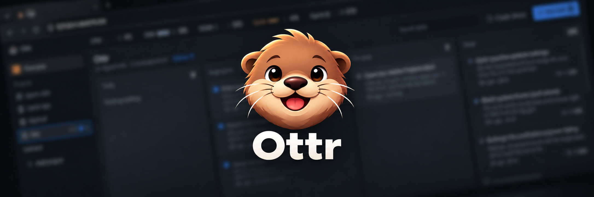
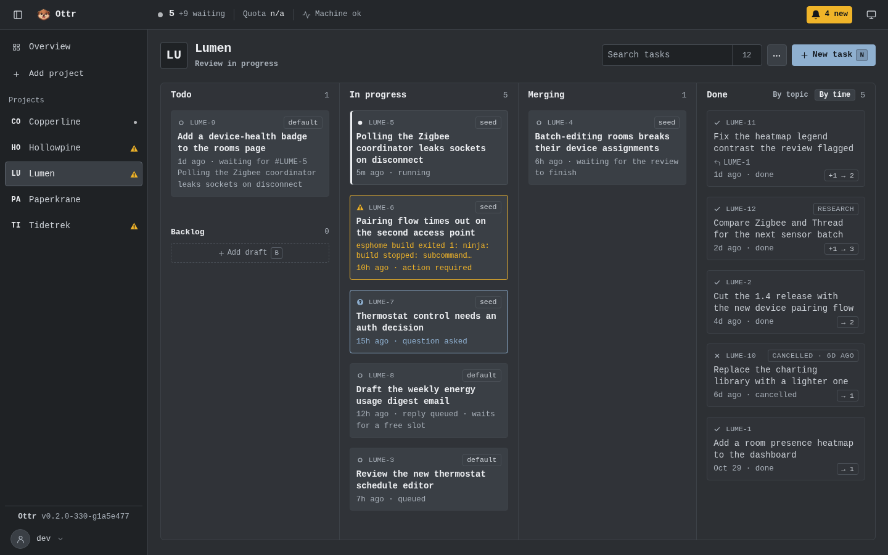
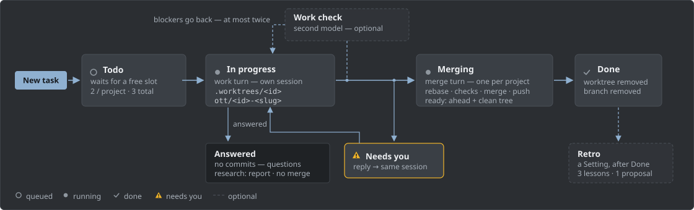
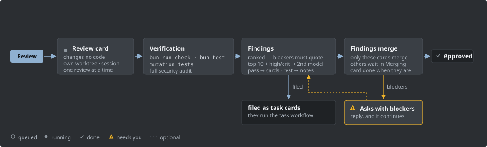
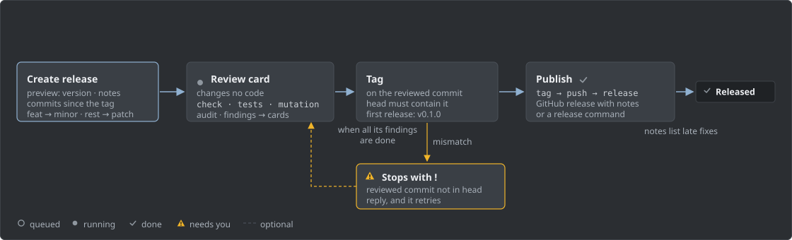

<p align="center">
  
</p>

<h1 align="center">Ottr – The Task Tracker for Oh My Pi</h1>

<p align="center">
  <a href="LICENSE"></a>
  <a href="https://bun.sh"></a>
  <a href="https://react.dev"></a>
  <a href="https://www.typescriptlang.org"></a>
  <a href="https://github.com/ottr-ai/ottr"></a>
</p>

Ottr (**O**hMyPi **T**ask **Tr**acker) is a local kanban board that runs omp coding agents on your git projects. You type a task in plain language. Ottr gives it a git worktree, runs the agent in it, checks the result, and merges through a per-project queue. It enforces the process; your project's `AGENTS.md` enforces quality. Everything runs on your machine; the board binds `127.0.0.1` by default.

Ottr is mainly built with Ottr itself.

<p align="center">
  
</p>

## How a task moves

<p align="center">
  
</p>

| Column | What happens |
|---|---|
| Todo | Waits for a free slot: 2 agents per project, 3 in total. Cards can declare dependencies and split into sub-task cards. |
| In progress | Ottr creates `.worktrees/<id>` on branch `ott/<id>-<slug>` and runs `omp -p` in it. The agent finishes with the `report_outcome` tool. |
| Merging | A second turn rebases, re-runs the project's checks, and integrates the work the way `AGENTS.md` says. One merge turn per project at a time. |
| Done | The report passed the git checks. Worktree and branch are gone. The lane shows the newest 20 cards and every unread card (an answer or a PR review not opened yet). **Show more** loads 20 more. A star on a done research card pins its report in a collapsible **Starred** section above the normal done cards. A cancelled card also shows here, with a **Cancelled** chip that names the cancel time; its drawer opens read-only, with no action buttons. |
| Backlog | Parks ideas that are not ready to run. The list sits under Todo below a divider. A grill session refines an idea; a grilled card moves to Todo. While the grill session runs, the card leaves the backlog row and shows as a normal card in the Todo lane. |

Ottr checks every report against git: `ready` needs commits ahead of the base and a clean worktree; `answered` needs no commits; `integrated` needs the branch head on the upstream branch.

Before a card enters the merge queue, a second memory-less model checks it (optional, **Settings**): it reads the card, the diff and the transcript, and hunts for test tampering, fabricated actions, unmet acceptance items, logic errors and security flaws. A blocker must quote the diff or transcript; at most two send-backs. After the third block, the card asks you with two buttons: **Send it back** or **Merge anyway**.

A **research** task answers a question instead of changing code: the agent writes a report that Ottr archives on the card. Research cards end `answered` and never merge. A starred done research card shows a star in place of the done check, and the star icon in its drawer pins the report in the done lane's **Starred** section, so you can find it again. The **Implement recommendations** button on a research report that names next steps starts a follow-up task that implements the recommended steps of the report. That task files a separate card for each independent piece of work.

A **backlog** card holds a feature idea that is not thought through yet. Park a draft with **Add draft** in the backlog row of the todo lane, or press **B**; a draft runs no agent and picks no model. Open the card and pick **Grill with the agent** — or **Move to todo** — and you pick the model at that moment, or leave it empty to use the project's role model: the agent asks rounds of questions, you answer with a click, and the refined task text lands in the report. When the item is ready, pick **Move to todo**; Ottr appends the grilled definition to the prompt and the card enters the normal queue.

For a project with a GitHub remote, Ottr watches CI after each merge push and files a follow-up card when a run fails. Once an hour it turns each open Dependabot pull request into a card that runs like any task.

A card with **!** needs you. Reply in its drawer and the agent continues in the same session. You can also steer a running task, stop its current turn, cancel any card, paste images, and start follow-ups from Done cards. The bell in the header collects everything that needs you; desktop and phone push notifications are optional. Cards can carry a **triage rank** (P0-P3, set in the drawer): the Overview triage ranks them ahead of wait time, and a close-candidate badge marks cards you plan to cancel.

When a running turn writes nothing to its task log for 2 hours, its card shows a warning: the agent may wait on a hung command. Ottr does not stop the run. Steer, stop, or cancel the card. The warning goes away when the log grows again. A log that reached its 2 MiB limit keeps no new text, but new output still clears the warning.

If a turn fails without stderr, its card shows the provider's error when the event stream has one. The task log records it too. Ottr removes stored secrets, labeled secrets, URL credentials, and common API tokens from this error. A check run that dies because its model's provider has no usable sign-in names the provider on the card, with the fix: sign in again under Settings. The bell lists an advisory for every configured model role whose provider's stored sign-in omp has disabled, with omp's disabled cause and the role names.

## Workflows: review and release

<p align="center">
  
</p>

<p align="center">
  
</p>

The project's **Review** button starts a read-only review card: full verification, mutation tests, and a security audit. It ranks its findings and files the confirmed ones as task cards, and it is done only when they are all done. **Review learnings** on the project's settings page carry standing conventions into every review card's prompt, so a finding that only restates a learning is treated as noise.

**Create release** runs the same review since the last tag, then tags the reviewed commit and creates the GitHub release. Versions follow Conventional Commits; notes are one bullet per commit. A commit body line `Supersedes: <sha>` or `Reverts: <sha>` (also git's `This reverts commit <sha>.`) removes the bullet of that commit when it is in the release. A revert of that line's commit cancels the removal. When all `Reverts:` and `Fixes: <sha>` lines of a commit name commits in the release, the commit gets no bullet of its own. A breaking commit always keeps its bullet. You can edit the notes on the release card while it is idle or waits for you. While the release card waits for your approval, its drawer lists the commits that landed after the reviewed one — each merge of a finding card marked "review fix", every other commit marked "not reviewed". Those commits join the published notes under **New features**, **Bug fixes** or **Other changes** by their commit type, the not-reviewed ones with a "(not reviewed)" suffix, and a late `Supersedes:`/`Reverts:` line drops the named commit's bullet there too. A project can set a **release command** instead, which runs at the reviewed commit with `OTTR_RELEASE_VERSION`, `OTTR_RELEASE_COMMIT`, `OTTR_RELEASE_NOTES_FILE` and `OTTR_ARCH_REVIEW` in its environment.

While a review is open, only its finding cards merge — a release ships reviewed work and its fixes, nothing else. Also, the **Create release** and **Review** buttons stay disabled until the open review or release and its findings are done.

A release card that waits for you with every finding done shows the held merges on the card and offers **Re-release**: it cancels the release and opens Create release, so a new review covers the fixes. A card that waits for such a release shows the hold and links to the release card. The board warnings name a release that holds merges for more than an hour after its last finding landed.

**Diagrams** shows `docs/how-it-works.md` as committed on the target branch, with each Mermaid block drawn as a diagram. **Create/update diagrams** at the top of that window asks for confirmation, then creates a normal task card. Its agent loads the `explain-project` skill and commits `docs/how-it-works.md` with Mermaid diagrams of the project; if the file already exists, the task updates it to match the code. The skill comes from agent-data, so the host and the workers must have it.

## Requirements

- Windows 10/11 or Linux, with [Bun](https://bun.sh) ≥ 1.4.2, git, and `omp` on `PATH`. (macOS is not supported yet.)
- `gh` ([GitHub CLI](https://cli.github.com)) only for releases, when **Settings** holds no GitHub token.
- omp must run its tools without approval prompts; a one-shot `omp -p` run cannot answer them.
- Ottr stores tokens and keys (GitHub, API key, session secret, and more) in plaintext in `.tasks/tracker.db`. Treat that file as a credential store.

## Quick start

Docker Compose is the preferred way to run Ottr: the board and its worker containers share one image, so every turn gets the same pinned toolchain, and a restart of the host machine brings the whole stack back. The stack is one file, [`docker-compose.yml`](docker-compose.yml).

### Latest release (no clone, no build)

Each GitHub release publishes the image as `ghcr.io/ottr-ai/ottr` (amd64), with the tags `<version>`, `v<version>` and `latest`. The image is public, so the pull needs no login. These lines fetch the compose file of the latest release and run that release's image.

Linux and macOS (bash, zsh):

```sh
mkdir -p ottr && cd ottr
TAG=$(curl -fsSL https://api.github.com/repos/ottr-ai/ottr/releases/latest | sed -n 's/.*"tag_name": *"\([^"]*\)".*/\1/p')
curl -fsSLo docker-compose.yml "https://raw.githubusercontent.com/ottr-ai/ottr/$TAG/docker-compose.yml"
export OTTR_IMAGE=ghcr.io/ottr-ai/ottr:$TAG             # the image of the same release
export OTTR_WORKER_TOKEN=$(openssl rand -hex 32)   # server-to-worker auth
export OTTR_OAUTH_DIR=~/.omp/oauth                 # provider sign-ins, read-only
mkdir -p "$OTTR_OAUTH_DIR"                         # Podman refuses a missing mount source
export OTTR_AGENT_DB=~/.omp/ottr-agent.db          # the stack's own omp auth db
# Turn Alate on (skip this when an Alate server already runs). The three settings
# go into .env once, so updates and new shells keep the same key.
[ -f .env ] || cat > .env <<EOF
COMPOSE_PROFILES=alate
ALATE_URL=http://alate:4570
ALATE_API_KEY=$(openssl rand -hex 32)
EOF
# Seed it once with a consistent copy of the host db. Never mount the live file.
[ -e "$OTTR_AGENT_DB" ] || bun -e 'new (require("bun:sqlite").Database)(process.argv[1], { readonly: true }).run("VACUUM INTO ?", [process.argv[2]])' ~/.omp/agent/agent.db "$OTTR_AGENT_DB"
docker compose pull
docker compose up -d --no-build
```

Windows (PowerShell 5.1 or 7):

```powershell
New-Item -ItemType Directory -Force ottr | Out-Null; Set-Location ottr
$TAG = (Invoke-RestMethod https://api.github.com/repos/ottr-ai/ottr/releases/latest).tag_name
Invoke-WebRequest -UseBasicParsing -OutFile docker-compose.yml "https://raw.githubusercontent.com/ottr-ai/ottr/$TAG/docker-compose.yml"
$env:OTTR_IMAGE = "ghcr.io/ottr-ai/ottr:$TAG"       # the image of the same release
$b = New-Object byte[] 32; [Security.Cryptography.RandomNumberGenerator]::Create().GetBytes($b)
$env:OTTR_WORKER_TOKEN = -join ($b | ForEach-Object { $_.ToString('x2') })   # server-to-worker auth
$env:OTTR_OAUTH_DIR = "$HOME\.omp\oauth"            # provider sign-ins, read-only
New-Item -ItemType Directory -Force $env:OTTR_OAUTH_DIR | Out-Null   # Podman refuses a missing mount source
$env:OTTR_AGENT_DB = "$HOME\.omp\ottr-agent.db"     # the stack's own omp auth db
# Turn Alate on (skip this when an Alate server already runs). The three settings
# go into .env once, so updates and new shells keep the same key.
if (-not (Test-Path .env)) {
  $b = New-Object byte[] 32; [Security.Cryptography.RandomNumberGenerator]::Create().GetBytes($b)
  $key = 'ALATE_API_KEY=' + (($b | ForEach-Object { $_.ToString('x2') }) -join '')
  @('COMPOSE_PROFILES=alate', 'ALATE_URL=http://alate:4570', $key) | Set-Content .env
}
# Seed it once with a consistent copy of the host db. Never mount the live file.
if (-not (Test-Path $env:OTTR_AGENT_DB)) { bun -e 'new (require(''bun:sqlite'').Database)(process.argv[1], { readonly: true }).run(''VACUUM INTO ?'', [process.argv[2]])' "$HOME\.omp\agent\agent.db" $env:OTTR_AGENT_DB }
docker compose pull
docker compose up -d --no-build
```

The compose file and the image come from the same tag, so they always match. To update to a newer release, run the same lines again from the folder above `ottr`. The `[ -e … ]`, `Test-Path`, and `[ -f .env ]` guards keep the existing `agent.db` snapshot and the same Alate key, and the named volumes keep the board data.

The `export` and `$env:` values live only in the current shell. Compose also reads a `.env` file in the same folder by itself, so put the values there (one `NAME=value` per line, for example `OTTR_WORKER_TOKEN=...`) and a new shell needs no exports. The Alate lines in the quick start already write the three Alate settings there; keep the `ALATE_API_KEY` line, because the board and alate must share one key.

### From source (main branch)

Linux and macOS (bash, zsh):

```sh
git clone git@github.com:ottr-ai/ottr.git ottr
cd ottr
export OTTR_WORKER_TOKEN=$(openssl rand -hex 32)   # server-to-worker auth
export OTTR_OAUTH_DIR=~/.omp/oauth                 # provider sign-ins, read-only
mkdir -p "$OTTR_OAUTH_DIR"                         # Podman refuses a missing mount source
export OTTR_AGENT_DB=~/.omp/ottr-agent.db          # the stack's own omp auth db
# Turn Alate on (skip this when an Alate server already runs). The three settings
# go into .env once, so updates and new shells keep the same key.
[ -f .env ] || cat > .env <<EOF
COMPOSE_PROFILES=alate
ALATE_URL=http://alate:4570
ALATE_API_KEY=$(openssl rand -hex 32)
EOF
# Seed it once with a consistent copy of the host db. Never mount the live file.
[ -e "$OTTR_AGENT_DB" ] || bun -e 'new (require("bun:sqlite").Database)(process.argv[1], { readonly: true }).run("VACUUM INTO ?", [process.argv[2]])' ~/.omp/agent/agent.db "$OTTR_AGENT_DB"
docker compose build
docker compose up -d
```

Windows (PowerShell 5.1 or 7):

```powershell
git clone git@github.com:ottr-ai/ottr.git ottr
Set-Location ottr
$b = New-Object byte[] 32; [Security.Cryptography.RandomNumberGenerator]::Create().GetBytes($b)
$env:OTTR_WORKER_TOKEN = -join ($b | ForEach-Object { $_.ToString('x2') })   # server-to-worker auth
$env:OTTR_OAUTH_DIR = "$HOME\.omp\oauth"            # provider sign-ins, read-only
New-Item -ItemType Directory -Force $env:OTTR_OAUTH_DIR | Out-Null   # Podman refuses a missing mount source
$env:OTTR_AGENT_DB = "$HOME\.omp\ottr-agent.db"     # the stack's own omp auth db
# Turn Alate on (skip this when an Alate server already runs). The three settings
# go into .env once, so updates and new shells keep the same key.
if (-not (Test-Path .env)) {
  $b = New-Object byte[] 32; [Security.Cryptography.RandomNumberGenerator]::Create().GetBytes($b)
  $key = 'ALATE_API_KEY=' + (($b | ForEach-Object { $_.ToString('x2') }) -join '')
  @('COMPOSE_PROFILES=alate', 'ALATE_URL=http://alate:4570', $key) | Set-Content .env
}
# Seed it once with a consistent copy of the host db. Never mount the live file.
if (-not (Test-Path $env:OTTR_AGENT_DB)) { bun -e 'new (require(''bun:sqlite'').Database)(process.argv[1], { readonly: true }).run(''VACUUM INTO ?'', [process.argv[2]])' "$HOME\.omp\agent\agent.db" $env:OTTR_AGENT_DB }
docker compose build
docker compose up -d
```

PowerShell 5.1 drops double quotes inside the arguments of native programs, so the PowerShell `bun -e` line uses only single quotes in its JavaScript.

### Podman

Podman runs the stack too, with four differences:

- `podman compose` needs a compose provider. Use Docker Compose v2 (`winget install Docker.DockerCompose`, then `$env:PODMAN_COMPOSE_PROVIDER = "docker-compose"`), or `pip install podman-compose`.
- Podman has no `local` log driver. Set `OTTR_LOG_DRIVER=k8s-file` (env or `.env`).
- podman-compose cannot parse Windows paths in volume mounts (`C:\...`). Either use Docker Compose v2 as the provider, or give the Podman machine's paths: `OTTR_OAUTH_DIR=/mnt/c/Users/<you>/.omp/oauth` and `OTTR_AGENT_DB=/mnt/c/Users/<you>/.omp/ottr-agent.db`.
- The default Podman machine has 2 GiB of RAM, and the server and each worker may use up to 8 GiB. Raise it: `podman machine stop; podman machine set --memory 16384; podman machine start`.

Podman Desktop shows no containers, or the board times out after you recreate the stack? See [docs/WORKERS.md, Troubleshooting](docs/WORKERS.md#troubleshooting).

### After the first start

The `VACUUM INTO` line copies the host omp `agent.db` only when the snapshot does not exist yet. The server and the workers write to the snapshot, so the host db stays unchanged. Do not copy the host db over the snapshot again: sign the stack in under **Settings → Provider sign-in** ([docs/WORKERS.md](docs/WORKERS.md#env-settings) tells why).

No data repo yet? Alate's `create-data-repo` skill builds a private one from the omp setup on your machine: install it with `npx skills add ottr-ai/alate --skill create-data-repo`, then ask your agent to run it. It scans for secrets first and asks before every step that leaves your machine (see [Alate, Start from your current setup](https://github.com/ottr-ai/alate#start-from-your-current-setup)).

The Alate lines in the quick start write `COMPOSE_PROFILES`, `ALATE_URL`, and `ALATE_API_KEY` into `.env`, and start the bundled Alate server (compose profile `alate`) together with the board. The board reads `ALATE_URL` and `ALATE_API_KEY` at boot and seeds **Settings → Alate** with them. A value saved under Settings wins over the env at every boot. A user whose Alate server already runs omits the Alate block and pairs the board under **Settings → Alate** instead.

The board never takes its config from the worker-writable home volume. With the Alate profile on, first open the Alate dashboard on <http://127.0.0.1:4570>. The alate container binds every interface, so the dashboard asks for the key: sign in with the `ALATE_API_KEY` value from `.env`. Then set the data repo there, and seed the board's own agent layer from your data repo once, and restart the board (see [Seed the board config](docs/WORKERS.md#seed-the-board-config)). Replace `OWNER/NAME` with your data repo. The lines are the same in bash and PowerShell:

```sh
docker compose run --rm board-seed --repo OWNER/NAME
docker compose restart server
```

The hourly deploy repeats the seed by itself when the env file sets `ALATE_DATA` (a local data-repo checkout) or `ALATE_DATA_REPO` (`owner/name`). The board shows a notice while its agent layer is not seeded, or while a model role's provider has no active sign-in.

The board is then on <http://127.0.0.1:8080>. Optional: `OTTR_PORT`, `HINDSIGHT_API_URL` for fleet memory, and provider keys pass through from the host shell. [docs/WORKERS.md](docs/WORKERS.md) has the full topology, updates and crash story.

Hindsight is the preferred way to share memory between workers. Without `HINDSIGHT_API_URL`, omp keeps its default `mnemopi` memory: a local store in the shared home volume, so only containers on the same host see it. Set the URL to a [Hindsight](https://github.com/vectorize-io/hindsight) server, and every worker on every machine reads and writes the same memory. See [docs/WORKERS.md](docs/WORKERS.md#fleet-memory-hindsight).

### Bare metal

The lines are the same in bash and PowerShell:

```sh
git clone git@github.com:ottr-ai/ottr.git ottr
cd ottr
bun install
bun start
```

Open <http://127.0.0.1:4747>. **Add project** clones any git URL (`https://…`, `git@host:…`, `ssh://host[:port]/…`) or creates a new project, sets up `.tasks/` and `.worktrees/`, and runs a short setup dialog (rules, automation, runners). Projects on hosts other than GitHub work with plain git; the GitHub extras (releases, CI watch, Dependabot cards, fork research, GHCR) stay GitHub-only and hide for other hosts. A project without `AGENTS.md` gets a rules interview card that writes one with you. Keep projects in a project folder: after a restart the board finds projects in Ottr's parent folder or in `OMP_TRACKER_ROOTS`.

## Alate

[Alate](https://github.com/ottr-ai/alate) is the provisioning side of the pair. It installs agent rules, skills, plugins and the omp user layer from a data repo onto this machine and into Ottr's Docker workers, so every agent and worker runs the same setup. Ottr integrates with it under **Settings → Alate**: point it at the alate server URL and API key, and **Provision now** (or the automatic check every 5 minutes) installs pending imports. With the URL set, Ottr also pulls the provider's update list each hour and offers upstream updates through the header bell. When an import waits longer than 30 minutes (the automatic check defers while cards run), the bell also shows "Alate is waiting to provision an import" with a link to the Settings section. The Overview page shows the provisioning state at a glance: the server's version and probe result, and which project lists (packages, tools, env) alate provisioned, under **Provisioning**.

## Configuration

| Setting | Default | How to change |
|---|---|---|
| Port | 4747 | env `PORT` |
| Bind address | 127.0.0.1 | env `OMP_TRACKER_HOST` |
| Public hostnames | none | env `OMP_TRACKER_PUBLIC_HOSTS`; requests under these hosts need a login or the API key |
| Project folders | Ottr's parent folder | env `OMP_TRACKER_ROOTS` |
| Task data location | each project's `.tasks/` | env `OTTR_DATA_DIR` (the compose stack sets `/data`) |
| Server-only project state (each `tasks.db`, fork caches) | same dir as task data | env `OTTR_SERVER_DATA_DIR` (the compose stack sets `/app/.tasks/projects`) |
| GitHub token | none | asked at onboarding; **Settings → Git hosts → GitHub token** replaces it; stored in `.tasks/tracker.db`. Settings shows the expiry date of this token and of the compose seed token, and the board pushes a reminder from 30 days before an expiry (spec: [docs/specs/token-expiry.md](docs/specs/token-expiry.md)). A GHE board needs a token issued on its own host, and git pushes to that host use the per-host tokens from **Settings → Git hosts** |
| GitHub host | `github.com` | env `OTTR_GITHUB_HOST` (a bare hostname), or **Settings → Git hosts → GitHub host**; a saved value wins over the env until cleared. A host under `*.ghe.com` is GitHub Enterprise Cloud with data residency (API at `api.<host>`); any other host is GitHub Enterprise Server (API at `<host>/api/v3`). Spec: [docs/specs/github-host.md](docs/specs/github-host.md) |
| GitHub App | none | optional; **Settings → Git hosts → GitHub App**; when set, posted PR reviews show as the app identity (`ottr[bot]` with a bot badge) instead of your own account; stored in `.tasks/tracker.db`; the key is write-only. Spec: [docs/specs/github-app.md](docs/specs/github-app.md); setup steps below |
| Git hosts | `OTTR_SSH_DIR` (default `~/.local/share/ottr/ssh`) | **Settings → Git hosts**: per-host HTTPS tokens (optional username) and a global SSH key; a project can set its own key in its **Settings**. Projects on other hosts clone with any `https://…`, `git@host:…` or `ssh://host[:port]/…` URL and work with plain git; the GitHub extras stay GitHub-only. Ottr tests each save with `git ls-remote` and asks you to confirm host-key fingerprints before it stores them. SSH keys stay in `OTTR_SSH_DIR`, outside every checkout. The server does each merge push with these credentials. |
| Running agents | 3 total, 2 per project | **Settings**; empty = no cap |
| Extra paths per worktree | none | **Settings** |
| Merge target branch | the repo's default branch (origin/HEAD) | **Settings**, per project: the branch on origin that finished cards merge into. Empty falls back to the repo's default branch, or the main checkout's upstream when origin/HEAD is missing |
| Alate provisioning | off | **Settings → Alate** (see [Alate](#alate)) |
| Provider sign-in | omp's existing sign-ins | **Settings → Provider sign-in**: omp's sign-ins and the full provider list its `omp login` offers; one sign-in per provider, on the machine that runs the board, and you can finish it from a phone by pasting the redirect address. For OAuth sign-ins of Anthropic, ChatGPT (Codex) and Z.AI, worker turns get a short-lived access token as env; other providers are marked "Not lent to workers" and the workers keep their own credential (see [docs/WORKERS.md](docs/WORKERS.md)) |
| Model roles | the data repo's `user/omp/agent/config.yml` | **Settings → Model roles**: set the model and the thinking level of each omp role, or add and remove a role. A save commits `config.yml` to Alate's GitHub data repo with the board's GitHub token (**Settings → Git hosts → GitHub token**; it needs write access to that repo). The commit has the loaded commit as its parent, and the branch moves only as a fast-forward, so a moved data repo gives a conflict. Alate then imports the commit and provisions the workers. On compose, the board copy changes at the next hourly seed. Needs **Settings → Alate** with a GitHub repo source. Spec: [docs/specs/model-roles-editor.md](docs/specs/model-roles-editor.md) |
| Retro | off | **Settings**, per project: files one retro card after each Done card |
| Fork research | off | **Settings**, per project: hourly watch of the project's GitHub forks; findings arrive as proposals you accept |
| PR reviews | off | **Settings**, per project: hourly watch of the project's open GitHub pull requests. For each new head, the server asks the model for a draft review in one tool-free call and files it on a review card, which wears the unread `new` badge until you open it; a new review of the same PR re-badges the card. No agent runs over the PR code. You edit the draft in the card and click **Post** to send one GitHub review with the `COMMENT` event; with the GitHub App configured the post goes out as `ottr[bot]`, without it under your own identity; after a post the card links the posted review. Spec: [docs/specs/pr-reviews.md](docs/specs/pr-reviews.md) |
| Hindsight server | env on compose | **Settings → Hindsight**: URL and API key for omp's memory backend |
| Review due | 150 commits | **Settings**, per project; see [docs/ARCH-REVIEWS.md](docs/ARCH-REVIEWS.md) |
| Release command | tag, push, GitHub release | **Settings**, one line; runs instead of those steps |
| Kept-worktree quarantine | 7 days | **Settings** |

### GitHub App setup

Do these steps once, so posted PR reviews show as `ottr[bot]`:

1. On GitHub, go to **Settings → Developer settings → GitHub Apps → New GitHub App**.
2. Name the app `Ottr`. When the name is taken, use `Ottr-<owner>`.
3. Leave the webhook off.
4. Set the permissions: **Pull requests: Read and write** and **Metadata: Read**.
5. Generate a private key and download the PEM file.
6. Install the app on the repositories to review.
7. Paste the App ID and the PEM into Ottr under **Settings → Git hosts → GitHub App**.

Spec: [docs/specs/github-app.md](docs/specs/github-app.md).

### Remote access

Public hostnames need a login (first visit creates the admin user) or the API key from **Settings**. Loopback access needs no login. Serve HTTPS with `tailscale serve --bg --https=443 http://127.0.0.1:4747`, set `OMP_TRACKER_PUBLIC_HOSTS`, and the board installs to a phone's home screen; Web Push (**Settings → Push**) then delivers "needs you" and "done" alerts. **Sign out everywhere** rotates the session secret and revokes all login sessions. Non-GET API requests must send an `Origin` header matching the board URL.

## Development

The commands are the same in bash and PowerShell:

```sh
bun run check          # tsc, biome, boot smoke, license allowlist
bun test
bun run test:mutation  # StrykerJS, five configs with break thresholds
bun run audit:quality  # duplicate and dead code
bun run dev            # UI-only demo board on port 5747
```

A mutation run stays inside the host CPU. Each config takes the concurrency from the CPU: half of `os.availableParallelism()`, at least 1, capped at the config's measured maximum. `STRYKER_CONCURRENCY` overrides this value when set. A worker runs one mutation run at a time: each run holds a lock file (`<tempDirName>.lock`) next to the Stryker sandbox. A second run waits and logs that it waits. A run removes a lock whose holder died.

A running card shows a live **Mutation testing** meter when the card's progress line matches the card format `<tool> <pct>% · <tested>/<total>[ · <stats tail>]`. The tail splits on ` · `, and a part like `38 survived (0.9%)`, `2 timed out`, `~2h 59m elapsed` or `~1h 23m left` becomes a labelled row while any other part shows raw. Ottr builds that line today from two tools only, in `src/stryker.ts`: a Stryker run (Node, read from the run's output through the `stryker-tap.cjs` copy when stdout is a pipe) and a Python `mutate.py` runner. Another tool needs no parser. Let the turn print one event line on the run's stdout stream, `{"type":"ottr_progress","text":"cargo-mutants 42% · 100/240 · 3 survived (1.2%)"}`, and the runner stores the `text` as the card's progress (`PROGRESS_EVENT` in `src/stryker.ts`, read in `src/runner.ts`). The meter's label stays `Mutation testing` whatever tool prints the line.

CI runs check, tests, dependency audit, e2e, gitleaks and zizmor on every push; weekly workflows add Docker build checks, Trivy and an OWASP ZAP baseline scan. Package versions stay 7 days back (`bunfig.toml`), and every action pins a full commit SHA.

For UI work use `bun run dev`: it seeds five demo projects in `.dev/`, starts no agents, and never touches a real board. It is also the way to refresh the screenshots under `.github/assets/`.

### Screenshot proofs for UI cards

A UI change needs a picture of the new surface. `bun run dev` serves the demo board on port 5747 and touches no real board.

1. Create the shots folder and start the demo board: `mkdir -p shots && bun run dev`.
2. Open the UI in a browser tab and drive it to the state you want to show.
3. Save each shot in one program step with puppeteer `page.screenshot({ path: 'shots/<name>.png' })`. Never move the image bytes through agent text.
4. Verify each file. The first eight bytes must print `89 50 4e 47 0d 0a 1a 0a`:

   ```sh
   for f in shots/*.png; do echo "$f: $(od -An -tx1 -N8 "$f")"; done
   ```

5. Pass the worktree-relative paths in `report_outcome`'s `shots` field, for example `shots/board.png`. The board rejects a path outside the worktree.

`/shots/` and `/*.png` sit in `.gitignore`, so the shots stay out of `git status` and never enter a commit.

## Docs

- [docs/how-it-works.md](docs/how-it-works.md): how Ottr works — architecture, the path of a task, and the task life cycle, with Mermaid diagrams.
- [docs/WORKERS.md](docs/WORKERS.md): the Docker Compose stack — topology, updates, env settings, fleet memory.
- [docs/ARCH-REVIEWS.md](docs/ARCH-REVIEWS.md): the **Review due** feature.
- [SECURITY.md](SECURITY.md): how to report a vulnerability.

## Built with Ottr badge

Did you build a project with Ottr? Add this badge to its README:

```html
<p align="center">
  <a href="https://github.com/ottr-ai/ottr"></a>
</p>
```

<p align="center">
  <a href="https://github.com/ottr-ai/ottr"></a>
</p>

## License

[MIT](LICENSE)
