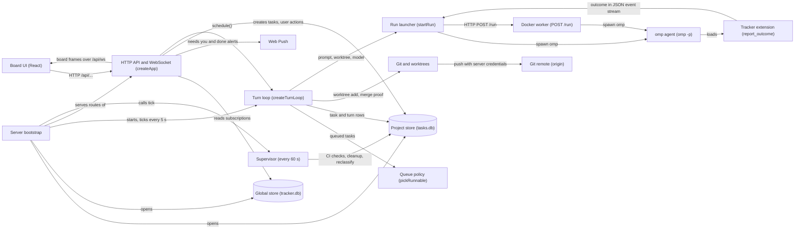
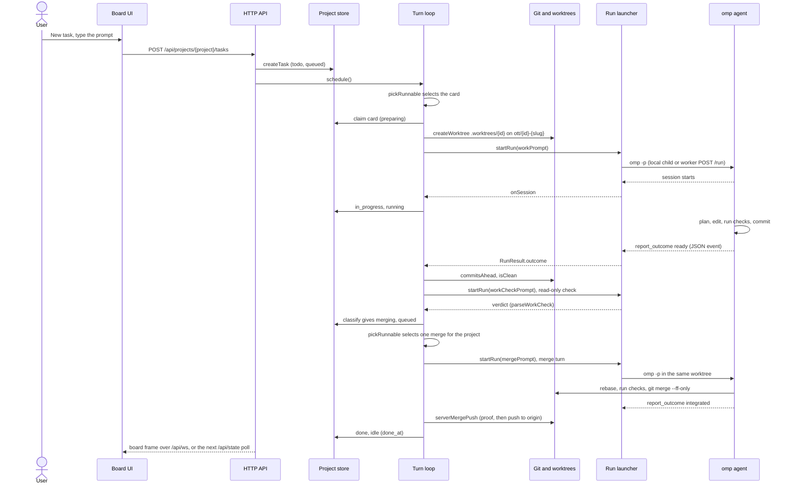
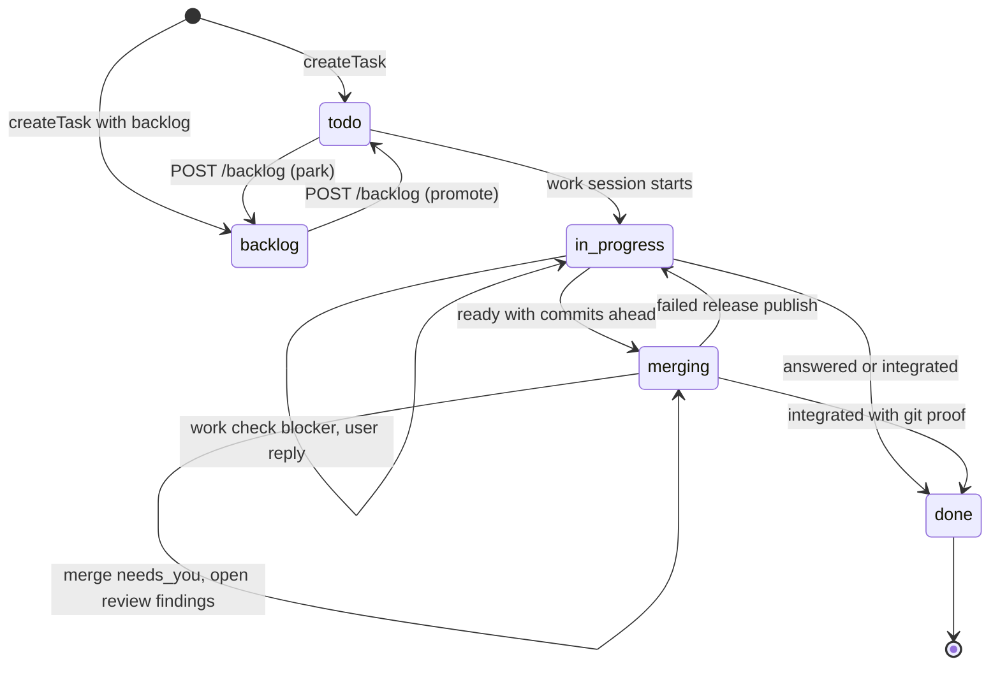
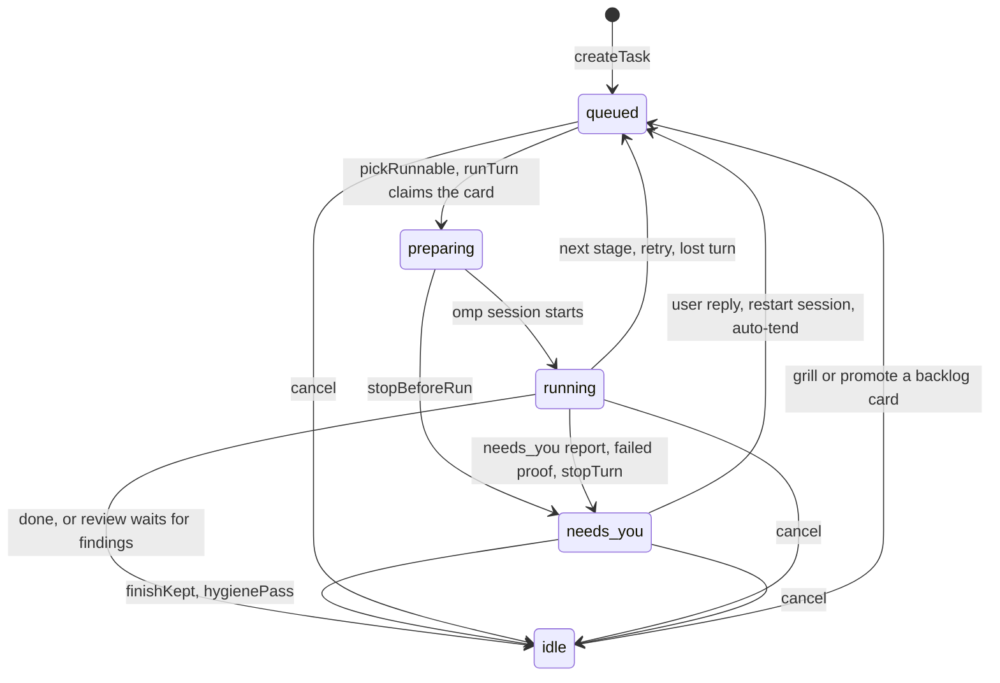

# How Ottr works

Ottr (the omp task tracker) is a local kanban board for one user. The user types a task as a card. Ottr gives the card a git worktree, runs an omp coding agent in it, checks the result, and merges the work through a merge queue for each project. One Bun server (`src/server.ts`) holds the HTTP API, the SQLite stores, the scheduler, and the git work. The React board in the browser shows the cards. Agent turns run as local `omp` child processes, or in Docker workers that the server calls over HTTP.

## Architecture

- **Board UI (React)** — `src/ui/app.tsx`, live updates in `src/ui/socket.ts` (`connectLive` uses `/api/ws`, `connectPolling` reads `/api/state` every 5 s in production)
- **HTTP API and WebSocket (createApp)** — `src/app.ts` (`createApp`), request checks in `src/requestGuards.ts`, login in `src/auth.ts`
- **Web Push** — `src/webpush.ts`
- **Server bootstrap** — `src/server.ts` (`Bun.serve`, project discovery, timers)
- **Supervisor (every 60 s)** — `src/supervisor.ts` (`tick`: worktree cleanup, CI watch, Dependabot cards, `reclassifyPass`, `hygienePass`)
- **Turn loop (createTurnLoop)** — `src/turn.ts` (`schedule`, `runTurn`, `cancel`, `stopTurn`, `settleLostTurn`)
- **Queue policy (pickRunnable)** — `src/scheduler.ts` (`pickRunnable`, `mergeHold`, `parseWorkCheck`)
- **Project store (tasks.db)** — `src/store.ts` (`ProjectStore.open`). One `tasks.db` for each project in `<project>/.tasks/`, or under `OTTR_SERVER_DATA_DIR`. Tables: `settings`, `tasks`, `turns`, `events`, `fork_branch`, `fork_runs`, `pr_review`, `pr_review_runs`, `learnings`.
- **Global store (tracker.db)** — `src/globalStore.ts` (`GlobalStore.open`, table `kv` in `.tasks/tracker.db`)
- **Run launcher (startRun)** — `src/runner.ts` (`startRun`, `buildOmpArgs`, `createRunSink`, `applyEvent`, `classify`, `workerFromEnv`)
- **Docker worker (POST /run)** — `src/workers.ts` (`serveWorker`, `runWorker`), entry point `src/worker.ts`, stack in `docker-compose.yml` and `Dockerfile.worker`, guide in `docs/WORKERS.md`
- **omp agent (omp -p)** — the external `omp` CLI. Prompts come from `src/prompts.ts` (`workPrompt`, `mergePrompt`, `workCheckPrompt`). Transcripts are read by `src/session.ts`.
- **Tracker extension (report_outcome)** — `extension/tracker.ts` (`pi.registerTool({ name: "report_outcome" })`)
- **Git and worktrees** — `src/worktree.ts` (`resolveTarget`, `createWorktree`, `isClean`, `serverMergePush`), host credentials in `src/gitHosts.ts`
- **Git remote (origin)** — the project's upstream repository. Only the server pushes to it (`serverMergePush`).

## A task from card to merge

- **User**, **Board UI** — `src/ui/app.tsx` (`NewTaskDialog`, `ComposeDialog`, `post`)
- **HTTP API** — `src/app.ts` (route `POST /api/projects/<project>/tasks` in `createApp`)
- **Project store** — `src/store.ts` (`createTask`, `updateTask`)
- **Turn loop** — `src/turn.ts` (`schedule`, `runTurn`) with `src/scheduler.ts` (`pickRunnable`, `parseWorkCheck`)
- **Git and worktrees** — `src/worktree.ts` (`createWorktree`, `isClean`, `serverMergePush`)
- **Run launcher** — `src/runner.ts` (`startRun`, `applyEvent`, `classify`), prompts in `src/prompts.ts`
- **omp agent** — the `omp` CLI with `extension/tracker.ts`, rules from the project's `AGENTS.md`

Notes:

- The work check runs inside the same `runTurn`, with a fresh session and only `read,grep,glob`. A blocker sends the card back to the agent. After two send-backs, the card asks the user: **Send it back** or **Merge anyway** (`src/turn.ts`). The reply route does the chosen action (`src/app.ts`). Other reply text goes to the agent.
- Merge turns run local, never on a worker. The agent does not push. `serverMergePush` pushes with the server's git credentials (`src/worktree.ts`).
- A `ready` report needs commits ahead of the base and a clean worktree. An `integrated` report needs the branch head on the upstream branch. Otherwise `classify` parks the card at `needs_you` (`src/runner.ts`).

## Life cycle

A task has two fields. `stage` is the board column. `state` is the run state inside that column. Both are in `src/types.ts` and in the `CHECK` constraints of the `tasks` table in `src/store.ts`.

### Stage

- **todo**, **in_progress**, **merging**, **done**, **backlog** — `Stage` in `src/types.ts`
- `createTask` — `src/store.ts`
- `POST /backlog` — `src/app.ts`
- Work session starts — `runTurn` `onSession` in `src/turn.ts`
- Report checks (`ready`, `answered`, `integrated`) — `classify` in `src/runner.ts`
- Work check blockers — `runTurn` in `src/turn.ts`
- Open review findings and failed release publish — `runTurn` and `settleReviews` in `src/turn.ts`

### Run state

- **queued**, **preparing**, **running**, **needs_you**, **idle** — `RunState` in `src/types.ts`
- `pickRunnable` — `src/scheduler.ts`. `runTurn`, `stopBeforeRun`, `stopTurn`, `cancel`, `finishKept`, `settleLostTurn` — `src/turn.ts`
- Next stage and retries — `classify` in `src/runner.ts`
- User reply, restart session, grill, promote — `POST /reply`, `POST /restart-session`, `POST /grill`, `POST /backlog` in `src/app.ts`
- Auto-tend, `hygienePass`, `reclassifyPass` — `src/supervisor.ts`
- `needs_you` shows as the `!` badge on the card — `src/ui/status.ts`
