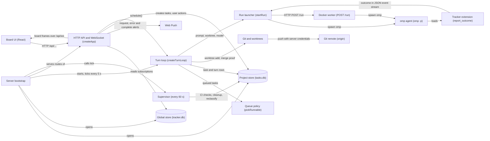
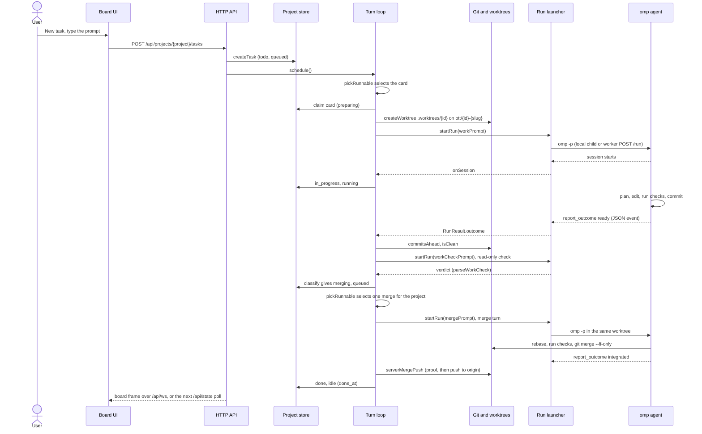
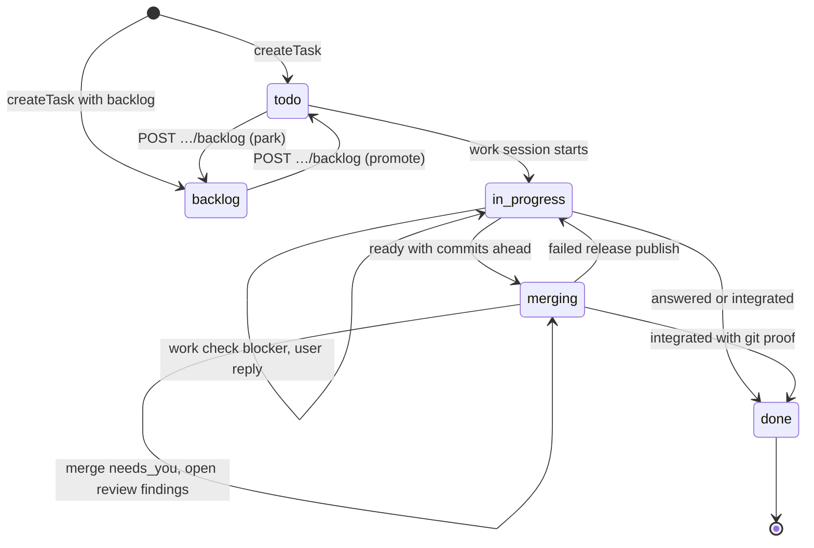
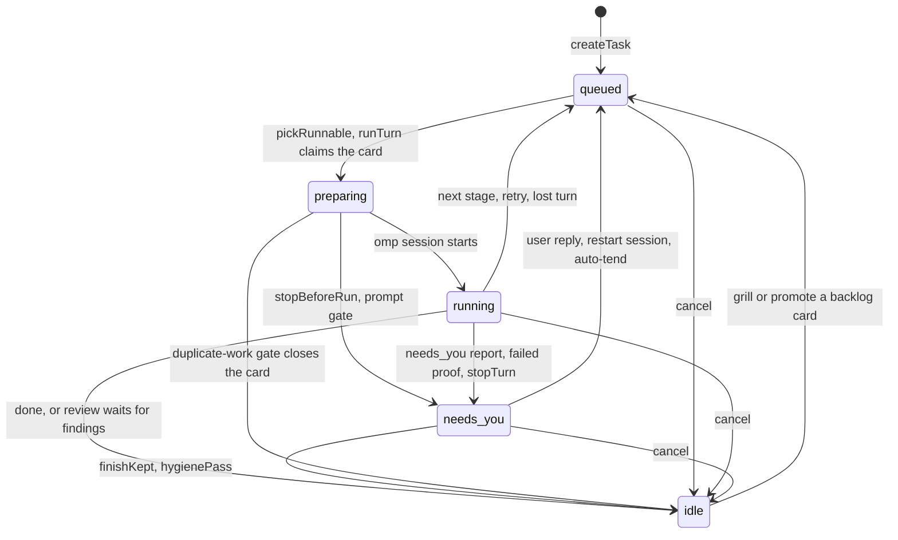
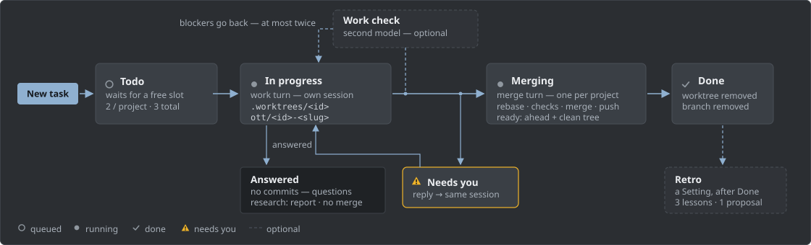
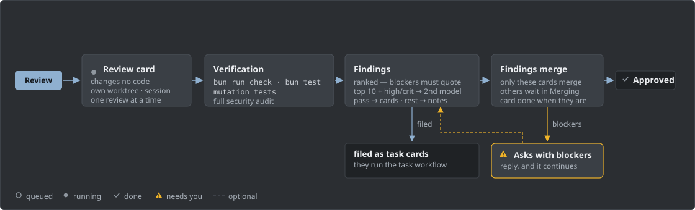
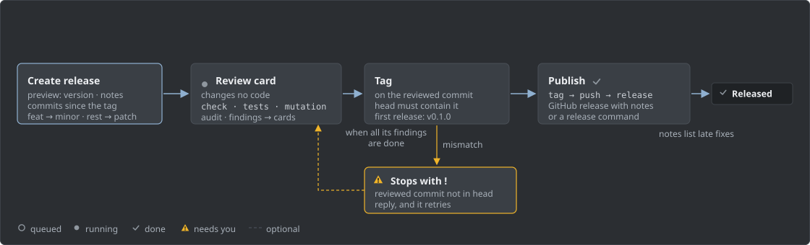

# How Ottr works

Ottr (the omp task tracker) is a local kanban board for one user. The user types a task as a card. Ottr gives the card a git worktree, runs an omp coding agent in it, checks the result, and merges the work through a merge queue for each project. One Bun server (`src/server.ts`) holds the HTTP API, the SQLite stores, the scheduler, and the git work. The React board in the browser shows the cards. Agent turns run as local `omp` child processes, or in Docker workers that the server calls over HTTP.

## Architecture

- **Board UI (React)** — `src/ui/app.tsx`, the Settings page in `src/ui/settings.tsx`, live updates in `src/ui/socket.ts` (`connectLive` uses `/api/ws`, `connectPolling` reads `/api/state` every 5 s in production)
- **HTTP API and WebSocket (createApp)** — `src/app.ts` (`createApp`), request checks in `src/requestGuards.ts`, login in `src/auth.ts`
- **Web Push** — `src/webpush.ts` (subscriptions, sending), event rules in `src/notifications.ts` (`diffEvents`, retraction, presence). See [notifications.md](notifications.md).
- **Server bootstrap** — `src/server.ts` (`Bun.serve`, project discovery, timers)
- **Supervisor (every 60 s)** — `src/supervisor.ts` (`tick`: worktree cleanup, CI watch, PR pass, Dependabot cards, `reclassifyPass`, `hygienePass`, worker sweep)
- **Turn loop (createTurnLoop)** — `src/turn.ts` (`schedule`, `runTurn`, `cancel`, `stopTurn`, `settleLostTurn`)
- **Queue policy (pickRunnable)** — `src/scheduler.ts` (`pickRunnable`, `mergeHold`, `parseWorkCheck`)
- **Project store (tasks.db)** — `src/store.ts` (`ProjectStore.open`). One `tasks.db` for each project in `<project>/.tasks/`, or under `OTTR_SERVER_DATA_DIR`. Tables: `settings`, `tasks`, `turns`, `events`, `fork_branch`, `fork_runs`, `pr_review`, `pr_review_runs`, `learnings` (retired and unused). Review conventions live in the project's AGENTS.md.
- **Global store (tracker.db)** — `src/globalStore.ts` (`GlobalStore.open`, table `kv` in `.tasks/tracker.db`)
- **Database backups** — `src/backup.ts` (`backupTick`, `runBackup`, `restoreSnapshot`), restore tool `src/restore.ts`, spec `docs/specs/db-backup.md`
- **Run launcher (startRun)** — `src/runner.ts` (`startRun`, `buildOmpArgs`, `createRunSink`, `applyEvent`, `classify`, `workerFromEnv`)
- **Docker worker (POST /run, POST /sweep)** — `src/workers.ts` (`serveWorker`, `runWorker`, `sweepWorker`), entry point `src/worker.ts`, stack in `docker-compose.yml` and `Dockerfile.worker`, guide in `docs/WORKERS.md`
- **omp agent (omp -p)** — the external `omp` CLI. Prompts come from `src/prompts.ts` (`workPrompt`, `mergePrompt`, `workCheckPrompt`). Transcripts are read by `src/session.ts`.
- **Tracker extension (report_outcome)** — `extension/tracker.ts` (`pi.registerTool({ name: "report_outcome" })`)
- **Git and worktrees** — `src/worktree.ts` (`resolveTarget`, `createWorktree`, `isClean`, `serverMergePush`), host credentials in `src/gitHosts.ts`. With `prMode` the server pushes the card branch and opens the PR instead of the target push (docs/specs/pr-mode.md). A Dependabot card's fixes beyond its PR's head go out as a follow-up PR — against the Dependabot branch, or against the target when the branch cherry-picked or rebased the bump — and the PR pass waits for both PRs (docs/specs/pr-mode.md, "The follow-up PR and the rebase answer")
- **Git remote (origin)** — the project's upstream repository. Only the server pushes to it (`serverMergePush`; with `prMode`, the card branch — docs/specs/pr-mode.md).

## A task from card to merge

- **User**, **Board UI** — `src/ui/app.tsx` (`NewTaskDialog`, `ComposeDialog`, `post`)
- **HTTP API** — `src/app.ts` (route `POST /api/projects/<project>/tasks` in `createApp`)
- **Project store** — `src/store.ts` (`createTask`, `updateTask`)
- **Turn loop** — `src/turn.ts` (`schedule`, `runTurn`) with `src/scheduler.ts` (`pickRunnable`, `parseWorkCheck`)
- **Git and worktrees** — `src/worktree.ts` (`createWorktree`, `isClean`, `serverMergePush`)
- **Run launcher** — `src/runner.ts` (`startRun`, `applyEvent`, `classify`), prompts in `src/prompts.ts`
- **omp agent** — the `omp` CLI with `extension/tracker.ts`, rules from the project's `AGENTS.md`

Notes:

- The work check runs inside the same `runTurn`, with a fresh session and only `read,grep,glob`. It judges the card's work result: the ready report plus the branch diff; the transcript is evidence for claimed runs only (`docs/specs/work-check.md`). A blocker sends the card back to the agent, and every ready report after a send-back gets a fresh check — the check then also gets the original report, the sent-back blockers, and only the commits since its last head. After four send-backs, the card asks the user: **Send it back** or **Merge anyway** (`src/turn.ts`). The reply route does the chosen action (`src/app.ts`). Other reply text goes to the agent. When the loop diverges — the blocker count did not drop over two consecutive send-backs, or one bug class repeats in two consecutive checks — the board parks the card at once instead of sending it back again, with the blocker counts per check and the repeated classes: **Send back with a new approach** (a typed reply carries your new direction), **Merge anyway**, or **Cancel** (`src/scheduler.ts`). A send-back after a repeated class names the class and asks the agent to write down the premise its fixes share and replace the approach when the premise is wrong. The cap of four send-backs stays the outer bound. When a check run stops at a provider usage limit, the board does not try again at once. The card waits in the queue until the reset time from `omp usage` (`holdUntil`), then the check runs again. A queue reorder does not change this wait. A message to the card ends the wait. If the reset time is not known, the card asks the user.
- Merge turns run local, never on a worker. The agent does not push. `serverMergePush` pushes with the server's git credentials (`src/worktree.ts`).
- A `ready` report needs commits ahead of the base and a clean worktree. An `integrated` report needs the branch head on the upstream branch. Otherwise `classify` parks the card at `needs_you` (`src/runner.ts`).

**Cross-project cards.** A card changes another project only by filing a card there: `create_task` with the `project` parameter files the card, and that card's own turns land the change. The work prompt still says that the agent never edits or commits in another project's checkout. After each work turn, the board compares that turn's window (turn start to turn end) with each change in every other project's main checkout. For a commit, the window overlaps the change when the commit time falls in the window. For a change with only files, the board uses the guard window. The board parks the card at `needs_you` only when this turn's window alone overlaps the change. It names the project, the commits and the files. When two or more turns overlap the change, no card parks: the board logs the change and shows one notice in the bell's Advisories section, with the commit and the running cards named.

One exemption exists. A work turn may commit its own project's provisioned copies under `projects/<project>/` in the agent-data main checkout, because the AGENTS.md sync rule names exactly that commit. The guard exempts a change whose files all sit under that path prefix, and it logs the exempt change. Every other change still parks a card or rings the notice. A card can wait for the card it filed: `report_outcome` and `create_task` accept `PROJECT-N` ids of other projects in `dependsOn`, and the scheduler holds the card until those cards are done or cancelled.

## Life cycle

A task has two fields. `stage` is the board column. `state` is the run state inside that column. Both are in `src/types.ts` and in the `CHECK` constraints of the `tasks` table in `src/store.ts`.

### Stage

- **todo**, **in_progress**, **merging**, **done**, **backlog** — `Stage` in `src/types.ts`
- `createTask` — `src/store.ts`
- `POST /api/projects/<project>/tasks/<id>/backlog` — `src/app.ts`
- Work session starts — `runTurn` `onSession` in `src/turn.ts`
- Report checks (`ready`, `answered`, `integrated`) — `classify` in `src/runner.ts`
- Work check blockers — `runTurn` in `src/turn.ts`
- Open review findings and failed release publish — `runTurn` and `settleReviews` in `src/turn.ts`

### Run state

- **queued**, **preparing**, **running**, **needs_you**, **idle** — `RunState` in `src/types.ts`
- `pickRunnable` — `src/scheduler.ts`. `runTurn`, `stopBeforeRun`, `stopTurn`, `cancel`, `finishKept`, `settleLostTurn` — `src/turn.ts`
- **Duplicate-work gate** — before the prompt gate, on the first work turn of a new card (a todo card with no session, branch, worktree, or earlier turn; `src/duplicateGate.ts`, spec `docs/specs/duplicate-gate.md`), one tool-free model call picks search terms from the prompt, `git grep` searches the turn's target ref in the main checkout, and a second tool-free call judges the prompt against those hits and the project's in-progress, merging, and done research cards without a follow-up. A full match cancels the card and names the reason with the matched task ids or paths in its needs-you reason. A partial match continues with an overlap note in the work prompt. A gate error lets the card through (fail open).
- **Prompt gate** — before the omp session of a gate-scoped work turn starts (`runTurn` after the claim, before the worktree; `src/promptGate.ts`, spec `docs/specs/prompt-gate.md`), one tool-free model call on the `@plan` role gets the card's effective prompt (prompt plus queued replies and steers) and, when the prompt names a handoff file in the project's handoffs folder, that file's text as an extra untrusted block, and answers strict JSON: what it would build, how it would check it, the five deepen points coverage, and each open question with a `default` — the answer the builder would take when the user stays silent, or `null` (OTTR-904). A question with a default never parks; only a blocking question (default `null`) or a missing outside check parks the card `needs_you`, with only the blocking questions as clickable asks, and a concrete `checks` answer is adopted as the check when point five is uncovered; no omp session spawns and no file changes. A pass stamps the assumptions and the adopted check in the gate state, the restatement lands in the card log, and the work turn prompt carries them as the untrusted **Gate assumptions** block; the agent's ready report lists the assumptions it used. A gateway failure, timeout, or malformed JSON parks with the reason and a **Start anyway** action after one retry; the same blocking questions twice carry that action in the ask itself. The gate re-runs whenever the effective prompt changes (edit, reply, steer) or the named handoff file's text changes, and skips merge, retro, review, release, board-check, grill, interview, scout, research, PR-adopt (Dependabot) and pr_review turns. Board-written prompts (the card a template or an agent filed; OTTR-850, `docs/specs/prompt-gate-board-prompts.md`) skip the model call: the row's `prompt_author` column decides, the deterministic Open questions park still runs, a user edit writes `user` and brings the model call back, and every board template and the filing tools name their outside check. After a deploy, one board-wide replay pass (`replayGateParks`, stamped in the global store's kv) re-queues each old gate park with no queued answer so the new park rule judges it once (OTTR-904). The composer's Deepen review shows the matching five-point proof next to its diff (`checkDeepened`, `src/deepen.ts`).
- Next stage and retries — `classify` in `src/runner.ts`
- User reply, restart session, grill, promote — `reply`, `restart-session`, `grill`, `backlog` under `POST /api/projects/<project>/tasks/<id>/` in `src/app.ts`
- Auto-tend, `hygienePass`, `reclassifyPass` — `src/supervisor.ts`
- `needs_you` shows as the `!` badge on the card — `src/ui/status.ts`

### Restart recovery

`server.ts` runs `recoverRestarted` once at boot (`src/turn.ts`). The sweep settles each open turn row whose run died with the old process and requeues the card through `settleLostTurn`.

One card skips the requeue. A tracker death can land between the server merge push and the settle write: the push already put the merge on origin, the SQLite write never ran, and the card stays `merging` and `running`. The sweep proves the landing the same way the settle's integration proof does: it fetches the pinned origin branch first (the tracker can die before the push helper writes the remote-tracking ref, so the cached ref can lag), then reads the card branch's head as an ancestor of the pushed target's remote-tracking ref (`finishPushedMergeAtBoot`, `src/turn.ts`). When the proof holds, the card finishes integrated with the settle's writes — the row outcome, `done` and `idle`, the Done metadata (target commit count and merge head), the push-sha pin, and the worktree removal. The repair never pushes, and a merge that never pushed fails the proof (a failed fetch included) and keeps the normal requeue. A second sweep pass skips the card at the `running`/`preparing` filter.

## How a task moves

  

| Column | What happens |
|---|---|
| Todo | Waits for a free slot: 2 agents per project, 3 in total. Cards can declare dependencies and split into sub-task cards. |
| In progress | Ottr creates `.worktrees/<id>` on branch `ott/<id>-<slug>` and runs `omp -p` in it. The agent finishes with the `report_outcome` tool. |
| Merging | A second turn rebases, re-runs the project's checks, and integrates the work the way `AGENTS.md` says. When the server push races a moved origin, the server first retries the rebase, checks and push itself, and only turns to a recovery merge turn when that cannot converge. One merge turn per project at a time. While main holds commits origin lacks, the project's other merges wait — `waiting for main to reach origin/main` — until a repairing merge pushes: the automatic server-side retry, or the parked card itself after you reply to it. |
| Done | The report passed the git checks. Worktree and branch are gone. The lane shows the newest 20 cards and every unread card (an answer or a PR review not opened yet). **Show more** loads 20 more. A star on a done research card pins its report in a collapsible **Starred** section above the normal done cards. A cancelled card also shows here, with a **Cancelled** chip that names the cancel time; its drawer opens read-only, with no action buttons. A project with a task that finished and whose drawer you have not opened yet shows a steel-blue dot in the left project list, ranked below needs action, asked and running; opening that task's drawer, by a click or a pasted link, clears it, and a task that lands in Done again shows the dot again. The read mark is kept on the server, so it holds across reloads and devices; tasks done before this dot shipped count as read. |
| Backlog | Parks ideas that are not ready to run. The list sits under Todo below a divider. A grill session refines an idea; a grilled card moves to Todo. While the grill session runs, the card leaves the backlog row and shows as a normal card in the Todo lane. |

On phones, stage tabs keep equal widths and complete labels.
Scroll the tab strip to reach more stages.
The strip keeps the active stage label in view after a tap, swipe, or keyboard change.
The Ottr logo links to the home page and keeps its accessible name when the wordmark is hidden.

Ottr checks every report against git: `ready` needs commits ahead of the base and a clean worktree; `answered` needs no commits; `integrated` needs the branch head on the upstream branch.

For an `answered` report, Ottr keeps the exact `summary` in the card and the turn record. A follow-up handoff includes the card summary under **Final outcome**. Call `report_outcome` directly, not through `eval`.

Before a card enters the merge queue, a second memory-less model checks it (optional, **Settings**): it reads the card, the diff and the transcript, and hunts for test tampering, fabricated actions, unmet acceptance items, logic errors and security flaws. A blocker must quote the diff or transcript; at most four send-backs. After the fifth block, the card asks you with two buttons: **Send it back** or **Merge anyway**. The board also asks at once when the loop diverges — the blocker count did not drop over two send-backs, or one bug class repeats in two checks — then with **Send back with a new approach**, **Merge anyway** or **Cancel**.

A **research** task answers a question instead of changing code: the agent writes a report that Ottr archives on the card. Research cards end `answered` and never merge. A starred done research card shows a star in place of the done check, and the star icon in its drawer pins the report in the done lane's **Starred** section, so you can find it again. The **Implement steps** button on a research report that recommends steps starts a follow-up task that implements the recommended steps of the report. That task files a separate card for each independent piece of work. A done card keeps every file its run left uncommitted: the board saves them into the project's `.tasks/quarantine/<task id>` folder before it removes the worktree, and the drawer lists them under **Saved files**; the research report also stays on the card as before.

A **backlog** card holds a feature idea that is not thought through yet. Park a draft with **Add draft** in the backlog row of the todo lane, or press **B**; a draft runs no agent and picks no model. Open the card and pick **Plan with agent** — or **Move to todo** — and you pick the model at that moment, or leave it empty to use the project's role model: the agent asks rounds of questions, you answer with a click, and the refined task text lands in the report. Before the agent reports, a fresh subagent that sees only the refined text says what it would build and lists its open questions. A mismatch gives one more round, and the check runs at most two times. Until a parked card starts, **Edit task** rewrites its text; the title follows the new text. When the item is ready, pick **Move to todo**; Ottr appends the grilled definition to the prompt and the card enters the normal queue.

For a project with a GitHub remote, Ottr watches CI after each merge push and answers a failed run on the card that owns the work: when the failed run's commit is exactly one done card's merge push, the board reopens that card with the failed steps' log in its prompt — a fresh worktree from the current target, the same session — and the fix ships through the normal merge flow. A run the board cannot match to one card (several cards in one push, a cancelled card, or a fix for the same failing check already under way on another card) files a follow-up card with the log, as before. When a card's text links a run (`https://github.com/<owner>/<repo>/actions/runs/<run_id>`), its drawer offers **Re-run failed jobs**: the board calls the rerun-failed-jobs API with its stored token, so a one-off flake never leaves the board. On a 403 or 404 the drawer shows an error naming the missing `actions:write` scope. Once an hour it turns each open Dependabot pull request into a card that runs like any task. A cancelled card keeps blocking its PR; the drawer's **Refile** action on the cancelled card files a fresh one with the source PR's fields, and a card that still covers the PR — open or done — refuses the refile.

A card with **!** needs you. Reply in its drawer and the agent continues in the same session. A todo card whose text is too vague to build without guessing (say, "add a password-forgotten feature") parks here before the agent changes any file: it asks you rounds of questions with clickable options, like a backlog grill, and builds once your answers settle the intent. The composer's **Deepen** rewrite never guesses those choices for you: it lists them under **Open questions**, and the agent asks them first. A model gate checks every work prompt a person wrote before the agent runs: open questions or a missing outside check park the card with clickable questions and a **Start anyway** override, cards the board filed itself skip the model call, and the Deepen review shows which of the five points the rewrite improved next to its diff. You can also steer a running task, edit a queued steer before the agent gets it, stop its current turn, cancel any card, paste images, and start follow-ups from Done cards; the follow-up dialog's **Project** picker files the follow-up into another project's board, linked back to the done card. The bell in the header collects everything that needs you; optional push notifications (**Settings → Notifications**) reach desktops and phones. See [docs/notifications.md](notifications.md). Cards can carry a **triage rank** (P0-P3, set in the drawer): the Overview triage ranks them ahead of wait time, and a close-candidate badge marks cards you plan to cancel.

Before the first turn of a new card, the duplicate-work gate checks if the work already exists in the code on main or in another card that is in progress, is merging, or is a done research card without a follow-up. When the whole work exists, the board cancels the new card and shows the reason with the matched cards or files in its drawer. When only a part exists, the card runs and its agent gets a note about the overlap.

A proposal card (a retro or fork proposal parked with **!**) opens on a **Decide** panel at the top of its drawer: what changes, why, the gain, the risk and the check, each on one line, with **Accept**, **Edit** and **Cancel** beside them and the full prompt under a collapsed section. The board card carries a **Decide** button that opens the drawer. Accept starts the card, Edit rewrites its prompt first, Cancel declines it. Older proposals without the stored summary show the prompt's first paragraph instead of the five lines.

When a running turn writes nothing to its task log for 2 hours, its card shows a warning: the agent may wait on a hung command. Ottr does not stop the run. Steer, stop, or cancel the card. The warning goes away when the log grows again. A log that reached its 2 MiB limit keeps no new text, but new output still clears the warning.

If a turn fails without stderr, its card shows the provider's error when the event stream has one. The task log records it too. Ottr removes stored secrets, labeled secrets, URL credentials, and common API tokens from this error. A check run that dies because its model's provider has no usable sign-in names the provider on the card, with the fix: sign in again under Settings. When a run serves another model than the card dispatched — the provider errored and omp's retry chain fell back — the task log names both models and the card keeps the pick for its next turn; the turn's row in **Work steps** reads "dispatched … , ran …". The bell lists an advisory for every configured model role whose provider's stored sign-in omp has disabled, with omp's disabled cause and the role names.

On screens ≤720px wide, **Overview → Projects** and **Performance** show labelled rows with native table semantics. Project links, **New task**, performance range controls, and **Context (max)** task links remain available. Desktop tables stay unchanged.

The **System** page (`/system`, in the sidebar under Overview) shows where the machine runs out. Each container (the server, then each worker in `OTTR_WORKER_URLS`) gets one row. A row shows its CPU against its share, memory used against its limit (cgroup `memory.current`, page cache included, as the kernel counts it against the limit), memory limit hits, OOM kills, the turns running on it, and its mutation lock holder and waiters, with one-hour sparklines. The numbers come from the container's own cgroup v2 files; workers report theirs on `GET /stats`. On a worker, each turn also shows its own share: memory now and its peak, CPU now, and the CPU time since the turn started. The worker reads these numbers from the turn's process tree in `/proc` (the `omp` process and all its child processes). Memory is the sum of Pss, so a shared page counts once across all turns. The turn with the most memory comes first. The peak comes from the 30 s samples, and it starts over when the board restarts. Server turns show no numbers. A row turns amber, with the reason as text, at 90 % of its memory limit, after an OOM kill in the last hour, or at 90 % of its CPU share for 5 minutes. The header then shows a warning mark that links to the page. A worker that does not answer reads "not reachable since HH:MM". The page also shows the Docker VM (CPU, load, available memory) and the board-wide holds: the update hold with its commits, running agents against the cap, and the queue with its oldest wait. Samples come every 30 s; the hour of history lives in memory and starts over when the board restarts.

## Workflows: review and release

  

  

The project's **Start review** button starts a read-only review card: full verification, mutation tests, a security audit, and a UI/UX check (the ui-ux-check skill) over the UI that the reviewed commits change. It ranks its findings, files the confirmed ones as task cards, files the ones tagged "Needs validation" as Backlog cards marked unverified (the second-model check never ran on them, and they never hold the review's Done) unless a card in the project already holds the lead's audit fingerprint or an open lead card already has the same title (case and whitespace do not count), and it is done only when its confirmed findings are all done. Each lead names its blocker on one line. Leads that wait on a fact only you know (for example a proxy setting) file one question card per review; your answer queues the lead card, cancels it, or leaves it in the Backlog with your answer. Leads that wait on a validation sandbox stay in the Backlog with a note. The findings live on the review card from the moment the reviewer records them, and Done waits until a check pass has covered them. Review conventions live in the project's AGENTS.md. Every review turn reads AGENTS.md in its worktree. The retired `learnings` table in tasks.db stays unused.

Normal, idle and release reviews also check implicit state machines.
The read-only check selects the two lifecycle fields with the most writers among fields that the reviewed commits write.
It checks writer guards and requires a call path plus test or command proof for each finding.
See the [review process](ARCH-REVIEWS.md#what-the-review-does) for its scope and proof rules.

Ottr's security phase uses `skill://security-audit-harness`, even when the generic prompt names `security-audit`. Normal reviews use all six phases with the `quick` profile and disclose partial coverage, including for generic full-audit requests. Only an explicit scheduled deep security review uses `deep`. The skill writes structured findings and a coverage ledger, and both must pass its validators before proposals or cards. Only `confirmed` records receive security severity. Reports retain blocked or unproven `needs_validation` records without severity.

The skill requires the Alate import and provision steps on each host and worker before use. If the skill is absent, the review reports this prerequisite instead of another skill. [The security audit spec](specs/security-audit-harness.md) defines verdicts, evidence, and sandbox rules. Other review gates stay unchanged.

**Create release** runs the same review since the last tag, then tags the reviewed commit and creates the GitHub release. Versions follow Conventional Commits; a model consolidates the commit list into short notes with Highlights, and the full one-bullet-per-commit list stays one click away. Both are editable before you start the release, and a failed model call falls back to the deterministic list. A commit body line `Supersedes: <sha>` or `Reverts: <sha>` (also git's `This reverts commit <sha>.`) removes the bullet of that commit when it is in the release. A revert of that line's commit cancels the removal. When all `Reverts:` and `Fixes: <sha>` lines of a commit name commits in the release, the commit gets no bullet of its own. A breaking commit always keeps its bullet. You can edit the notes on the release card while it is idle or waits for you. While the release card waits for your approval, its drawer lists the commits that landed after the reviewed one — each merge of a finding card marked "review fix", every other commit marked "not reviewed". Those commits join the published notes under **New features**, **Bug fixes** or **Other changes** by their commit type, the not-reviewed ones with a "(not reviewed)" suffix, and a late `Supersedes:`/`Reverts:` line drops the named commit's bullet there too. A project can set a **release command** instead, which runs at the reviewed commit with `OTTR_RELEASE_VERSION`, `OTTR_RELEASE_COMMIT`, `OTTR_RELEASE_NOTES_FILE` and `OTTR_ARCH_REVIEW` in its environment.

The project header's release chip shows the repo's latest GitHub release — its name when the release's tag is not `vX.Y.Z` — and falls back to the highest `vX.Y.Z` tag merged into the target when the project has no GitHub remote or GitHub does not answer. When the latest GitHub release is not `vX.Y.Z`, Create release stays blocked with an explanation instead of offering a computed next version: Ottr's release flow only tags `vX.Y.Z`. When the project has a GitHub remote, the header also shows its open pull requests: up to three `#number` links (the title on hover, drafts marked), and more than three collapse into one count link to the repo's pulls page. The list re-probes GitHub about every ten minutes and hides itself when GitHub does not answer.

While a review is open, only its finding cards merge — a release ships reviewed work and its fixes, nothing else. Also, the **Create release** and **Start review** buttons stay disabled until the open review or release and its findings are done.

A release card that waits for you with every finding done shows the held merges on the card and offers **Release again**: it cancels the release and opens Create release, so a new review covers the fixes. A card that waits for such a release shows the hold and links to the release card. The board warnings name a release that holds merges for more than an hour after its last finding landed.

**Show diagrams** opens `docs/how-it-works.md` as committed on the target branch, with each Mermaid block drawn as a diagram. **Create/update diagrams** at the top of that window asks for confirmation, then creates a normal task card. Its agent loads the `explain-project` skill and commits `docs/how-it-works.md` with Mermaid diagrams of the project; if the file already exists, the task updates it to match the code. See [Required skills](#required-skills) for where each skill lives.

## Required skills

The board's prompts name skills and rules. A prompt stops with a `needs_you` report when its runner lacks one. The board compares the workers' installed skills with this list and shows the missing ones in **Settings → Alate** and on the affected buttons.

| Skill or rules | Source | Used by |
| --- | --- | --- |
| `check-ottr-board` | ships in this repo: `.agents/skills/check-ottr-board` | the **Check the board** button |
| `diff-security-review` | ships in this repo: `.agents/skills/diff-security-review`; ported from [anthropics/claude-code-security-review](https://github.com/anthropics/claude-code-security-review) (MIT) | every merge turn |
| `explain-project` | ships in this repo: `.agents/skills/explain-project` | the **Create/update diagrams** button |
| `ui-ux-check` | ships in this repo: `.agents/skills/ui-ux-check` | reviews of projects with a UI |
| `security-audit` | [cloudflare/security-audit-skill](https://github.com/cloudflare/security-audit-skill); Ottr substitutes its own `security-audit-harness` when present | every review |
| codeguard rules | [cosai-oasis/project-codeguard](https://github.com/cosai-oasis/project-codeguard) | every review |
| `codebase-design` | [mattpocock/skills](https://github.com/mattpocock/skills) | review architecture lens |
| `ponytail-audit` | [DietrichGebert/ponytail](https://github.com/DietrichGebert/ponytail) | review architecture lens |
| `retro` | ships in this repo: `.agents/skills/retro` | the end-of-task retro |

omp loads `.agents/skills/` from the repo for runs in this checkout. Install a shipped skill into another home with the skills CLI (`npx skills add`). The third-party skills come from their repos with the skills CLI or a data repo.

**Optional shipped skills** — no board prompt needs them; install one into another home with the skills CLI when you want it:

- `llm-to-code` ships in this repo: `.agents/skills/llm-to-code` — finds the recurring agent workflows worth moving, moves the fixed steps of an agent workflow into a script and keeps the model only where real interpretation stays, with `scripts/profile-session.ts` as a session cost profiler.
- `web-perf-audit` ships in this repo: `.agents/skills/web-perf-audit` — verifies generic performance tips against the code with file:line evidence and real size and header measurements, then writes a verdict report.

