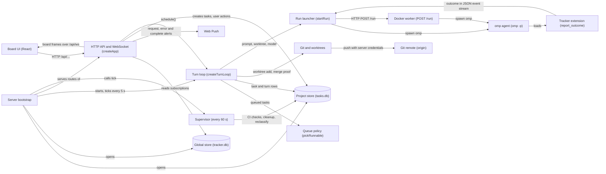
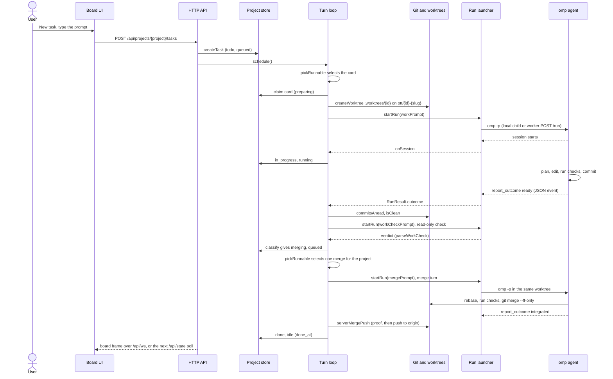
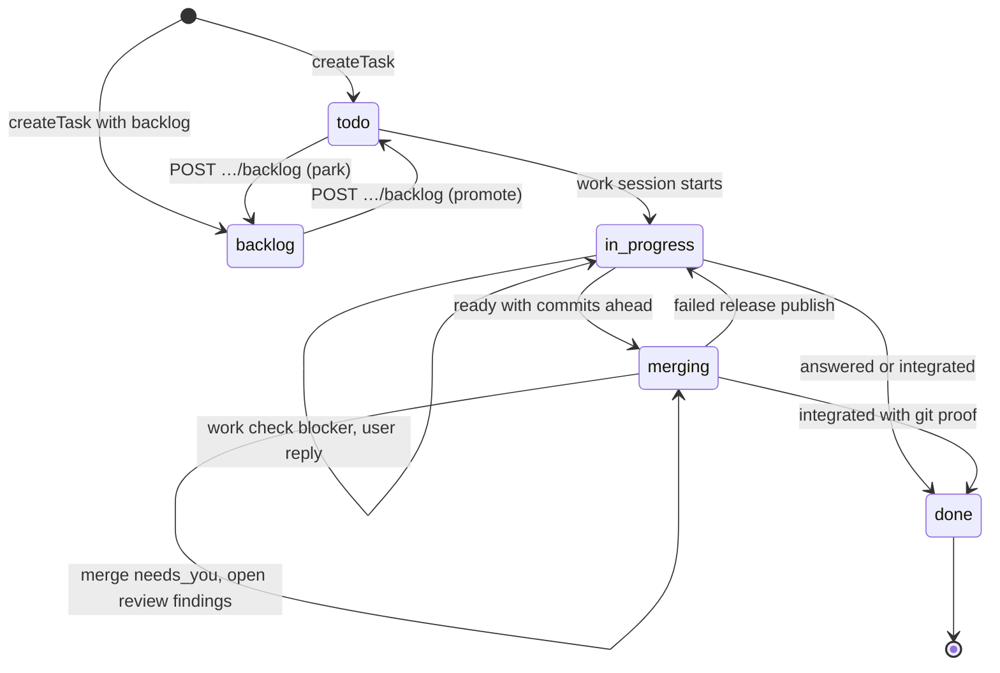
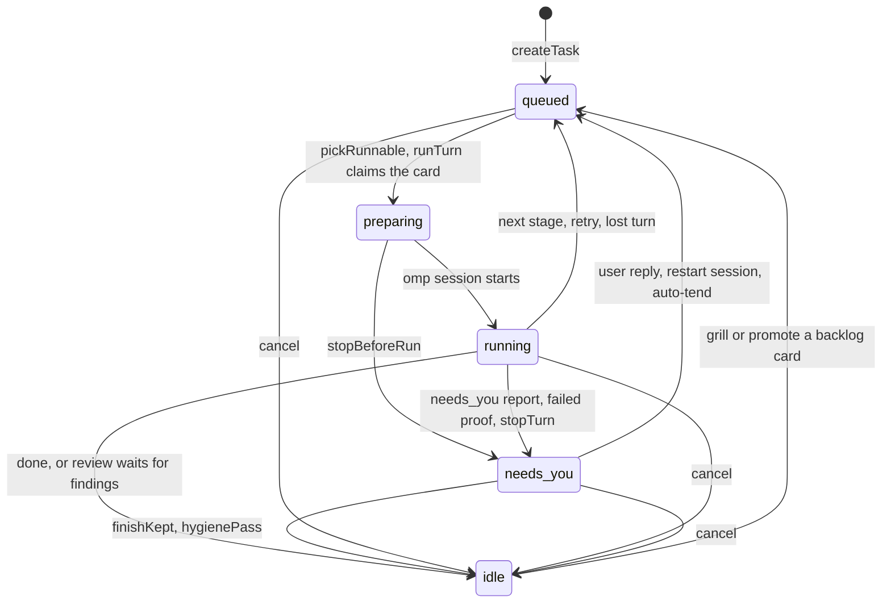

# How Ottr works

Ottr (the omp task tracker) is a local kanban board for one user. The user types a task as a card. Ottr gives the card a git worktree, runs an omp coding agent in it, checks the result, and merges the work through a merge queue for each project. One Bun server (`src/server.ts`) holds the HTTP API, the SQLite stores, the scheduler, and the git work. The React board in the browser shows the cards. Agent turns run as local `omp` child processes, or in Docker workers that the server calls over HTTP.

## Architecture

- **Board UI (React)** — `src/ui/app.tsx`, the Settings page in `src/ui/settings.tsx`, live updates in `src/ui/socket.ts` (`connectLive` uses `/api/ws`, `connectPolling` reads `/api/state` every 5 s in production)
- **HTTP API and WebSocket (createApp)** — `src/app.ts` (`createApp`), request checks in `src/requestGuards.ts`, login in `src/auth.ts`
- **Web Push** — `src/webpush.ts` (subscriptions, sending), event rules in `src/notifications.ts` (`diffEvents`, retraction, presence). See [notifications.md](notifications.md).
- **Server bootstrap** — `src/server.ts` (`Bun.serve`, project discovery, timers)
- **Supervisor (every 60 s)** — `src/supervisor.ts` (`tick`: worktree cleanup, CI watch, PR pass, Dependabot cards, `reclassifyPass`, `hygienePass`, worker sweep)
- **Turn loop (createTurnLoop)** — `src/turn.ts` (`schedule`, `runTurn`, `cancel`, `stopTurn`, `settleLostTurn`)
- **Queue policy (pickRunnable)** — `src/scheduler.ts` (`pickRunnable`, `mergeHold`, `parseWorkCheck`)
- **Project store (tasks.db)** — `src/store.ts` (`ProjectStore.open`). One `tasks.db` for each project in `<project>/.tasks/`, or under `OTTR_SERVER_DATA_DIR`. Tables: `settings`, `tasks`, `turns`, `events`, `fork_branch`, `fork_runs`, `pr_review`, `pr_review_runs`, `learnings` (retired and unused). Review conventions live in the project's AGENTS.md.
- **Global store (tracker.db)** — `src/globalStore.ts` (`GlobalStore.open`, table `kv` in `.tasks/tracker.db`)
- **Database backups** — `src/backup.ts` (`backupTick`, `runBackup`, `restoreSnapshot`), restore tool `src/restore.ts`, spec `docs/specs/db-backup.md`
- **Run launcher (startRun)** — `src/runner.ts` (`startRun`, `buildOmpArgs`, `createRunSink`, `applyEvent`, `classify`, `workerFromEnv`)
- **Docker worker (POST /run, POST /sweep)** — `src/workers.ts` (`serveWorker`, `runWorker`, `sweepWorker`), entry point `src/worker.ts`, stack in `docker-compose.yml` and `Dockerfile.worker`, guide in `docs/WORKERS.md`
- **omp agent (omp -p)** — the external `omp` CLI. Prompts come from `src/prompts.ts` (`workPrompt`, `mergePrompt`, `workCheckPrompt`). Transcripts are read by `src/session.ts`.
- **Tracker extension (report_outcome)** — `extension/tracker.ts` (`pi.registerTool({ name: "report_outcome" })`)
- **Git and worktrees** — `src/worktree.ts` (`resolveTarget`, `createWorktree`, `isClean`, `serverMergePush`), host credentials in `src/gitHosts.ts`. With `prMode` the server pushes the card branch and opens the PR instead of the target push (docs/specs/pr-mode.md)
- **Git remote (origin)** — the project's upstream repository. Only the server pushes to it (`serverMergePush`; with `prMode`, the card branch — docs/specs/pr-mode.md).

## A task from card to merge

- **User**, **Board UI** — `src/ui/app.tsx` (`NewTaskDialog`, `ComposeDialog`, `post`)
- **HTTP API** — `src/app.ts` (route `POST /api/projects/<project>/tasks` in `createApp`)
- **Project store** — `src/store.ts` (`createTask`, `updateTask`)
- **Turn loop** — `src/turn.ts` (`schedule`, `runTurn`) with `src/scheduler.ts` (`pickRunnable`, `parseWorkCheck`)
- **Git and worktrees** — `src/worktree.ts` (`createWorktree`, `isClean`, `serverMergePush`)
- **Run launcher** — `src/runner.ts` (`startRun`, `applyEvent`, `classify`), prompts in `src/prompts.ts`
- **omp agent** — the `omp` CLI with `extension/tracker.ts`, rules from the project's `AGENTS.md`

Notes:

- The work check runs inside the same `runTurn`, with a fresh session and only `read,grep,glob`. It judges the card's work result: the ready report plus the branch diff; the transcript is evidence for claimed runs only (`docs/specs/work-check.md`). A blocker sends the card back to the agent, and every ready report after a send-back gets a fresh check — the check then also gets the original report, the sent-back blockers, and only the commits since its last head. After four send-backs, the card asks the user: **Send it back** or **Merge anyway** (`src/turn.ts`). The reply route does the chosen action (`src/app.ts`). Other reply text goes to the agent. When the loop diverges — the blocker count did not drop over two consecutive send-backs, or one bug class repeats in two consecutive checks — the board parks the card at once instead of sending it back again, with the blocker counts per check and the repeated classes: **Send back with a new approach** (a typed reply carries your new direction), **Merge anyway**, or **Cancel** (`src/scheduler.ts`). A send-back after a repeated class names the class and asks the agent to write down the premise its fixes share and replace the approach when the premise is wrong. The cap of four send-backs stays the outer bound. When a check run stops at a provider usage limit, the board does not try again at once. The card waits in the queue until the reset time from `omp usage` (`holdUntil`), then the check runs again. A queue reorder does not change this wait. A message to the card ends the wait. If the reset time is not known, the card asks the user.
- Merge turns run local, never on a worker. The agent does not push. `serverMergePush` pushes with the server's git credentials (`src/worktree.ts`).
- A `ready` report needs commits ahead of the base and a clean worktree. An `integrated` report needs the branch head on the upstream branch. Otherwise `classify` parks the card at `needs_you` (`src/runner.ts`).

**Cross-project cards.** A card changes another project only by filing a card there: `create_task` with the `project` parameter files the card, and that card's own turns land the change. The work prompt still says that the agent never edits or commits in another project's checkout. After each work turn, the board compares that turn's window (turn start to turn end) with each change in every other project's main checkout. For a commit, the window overlaps the change when the commit time falls in the window. For a change with only files, the board uses the guard window. The board parks the card at `needs_you` only when this turn's window alone overlaps the change. It names the project, the commits and the files. When two or more turns overlap the change, no card parks: the board logs the change and shows one notice in the bell's Advisories section, with the commit and the running cards named.

One exemption exists. A work turn may commit its own project's provisioned copies under `projects/<project>/` in the agent-data main checkout, because the AGENTS.md sync rule names exactly that commit. The guard exempts a change whose files all sit under that path prefix, and it logs the exempt change. Every other change still parks a card or rings the notice. A card can wait for the card it filed: `report_outcome` and `create_task` accept `PROJECT-N` ids of other projects in `dependsOn`, and the scheduler holds the card until those cards are done or cancelled.

## Life cycle

A task has two fields. `stage` is the board column. `state` is the run state inside that column. Both are in `src/types.ts` and in the `CHECK` constraints of the `tasks` table in `src/store.ts`.

### Stage

- **todo**, **in_progress**, **merging**, **done**, **backlog** — `Stage` in `src/types.ts`
- `createTask` — `src/store.ts`
- `POST /api/projects/<project>/tasks/<id>/backlog` — `src/app.ts`
- Work session starts — `runTurn` `onSession` in `src/turn.ts`
- Report checks (`ready`, `answered`, `integrated`) — `classify` in `src/runner.ts`
- Work check blockers — `runTurn` in `src/turn.ts`
- Open review findings and failed release publish — `runTurn` and `settleReviews` in `src/turn.ts`

### Run state

- **queued**, **preparing**, **running**, **needs_you**, **idle** — `RunState` in `src/types.ts`
- `pickRunnable` — `src/scheduler.ts`. `runTurn`, `stopBeforeRun`, `stopTurn`, `cancel`, `finishKept`, `settleLostTurn` — `src/turn.ts`
- Next stage and retries — `classify` in `src/runner.ts`
- User reply, restart session, grill, promote — `reply`, `restart-session`, `grill`, `backlog` under `POST /api/projects/<project>/tasks/<id>/` in `src/app.ts`
- Auto-tend, `hygienePass`, `reclassifyPass` — `src/supervisor.ts`
- `needs_you` shows as the `!` badge on the card — `src/ui/status.ts`

### Restart recovery

`server.ts` runs `recoverRestarted` once at boot (`src/turn.ts`). The sweep settles each open turn row whose run died with the old process and requeues the card through `settleLostTurn`.

One card skips the requeue. A tracker death can land between the server merge push and the settle write: the push already put the merge on origin, the SQLite write never ran, and the card stays `merging` and `running`. The sweep proves the landing the same way the settle's integration proof does: it fetches the pinned origin branch first (the tracker can die before the push helper writes the remote-tracking ref, so the cached ref can lag), then reads the card branch's head as an ancestor of the pushed target's remote-tracking ref (`finishPushedMergeAtBoot`, `src/turn.ts`). When the proof holds, the card finishes integrated with the settle's writes — the row outcome, `done` and `idle`, the Done metadata (target commit count and merge head), the push-sha pin, and the worktree removal. The repair never pushes, and a merge that never pushed fails the proof (a failed fetch included) and keeps the normal requeue. A second sweep pass skips the card at the `running`/`preparing` filter.
